<div align="center">

<picture>
  <source media="(prefers-color-scheme: dark)" srcset="docs/grafik/banner-dunkel.svg">
  
</picture>

<br/><br/>

[](https://github.com/thisislennard/BlaulichtCMS/releases/latest)
[](https://github.com/thisislennard/BlaulichtCMS/actions/workflows/ci.yml)
[](LICENSE)


**[Projektumfang](#projektumfang) · [Idee](#idee) · [Schnittstellen](#schnittstellen) · [Workflows](#workflows) · [Technische Umsetzung](#technische-umsetzung)**

</div>

> [!NOTE]
> **Funktional vollständig.** Mit Version 0.7.1 ist der geplante Funktionsumfang umgesetzt. Weiterentwickelt werden jetzt
> Feinheiten und bei Bedarf weitere Schnittstellen zu anderen Systemen. Alle Screenshots stammen aus einer Testinstanz
> mit fiktiven Daten.

<br/>

## Projektumfang

BlaulichtCMS begleitet die Öffentlichkeitsarbeit vom Foto am Einsatzort bis zum veröffentlichten Beitrag – und bündelt
alles, was dazugehört, in einer Anwendung auf dem eigenen Server.

<picture>
  <source media="(prefers-color-scheme: dark)" srcset="docs/grafik/umfang-dunkel.svg">
  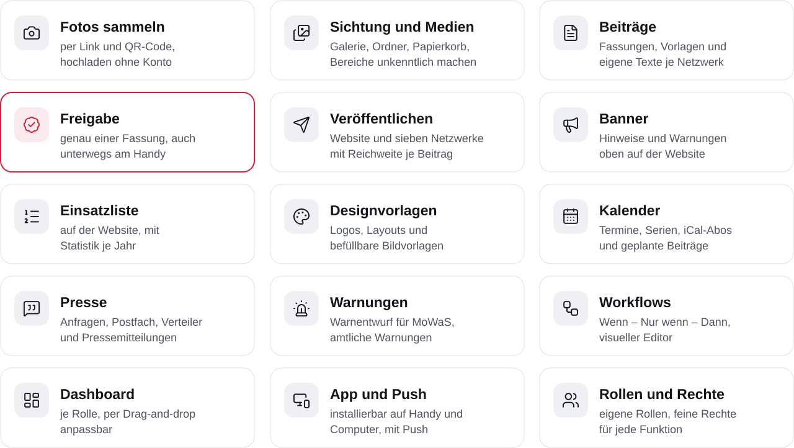
</picture>

<br/><br/>

| Bereich | Umfang |
|---|---|
| **Übersicht** | Dashboard je Rolle, eine Freigaben-Liste für alle Arten, Benachrichtigungen per Glocke, Push und E-Mail, Reichweite der Social-Posts |
| **Redaktion** | Fotos sammeln per Upload-Link, Sichtung und Medien, Beiträge mit Fassungen, Kalender, Einsatzliste, Banner, Designvorlagen, Quellen |
| **Presse** | Presseanfragen mit Fristen, Presse-Postfach, Antworten mit Textbausteinen, Presseverteiler und Pressemitteilungen |
| **Warnungen** | Warnentwurf für die MoWaS-Übergabe mit Warnstufen-Assistent, Stichwortverzeichnis je Bundesland, amtliche Warnungen |
| **Einrichtung** | Websites, Verbindungen, Workflows, Beitragsvorlagen, Upload-Seite |
| **Verwaltung** | Benutzer und eigene Rollen mit 101 Rechten, Einstellungen, Sicherung, Updates aus der App, Systemstatus |

Dazu: installierbare App für Handy und Computer, Suche über alle Bereiche mit <kbd>Strg</kbd> + <kbd>K</kbd>,
Hilfe-Center mit 32 Kapiteln, heller und dunkler Modus, vollständig per Tastatur bedienbar.

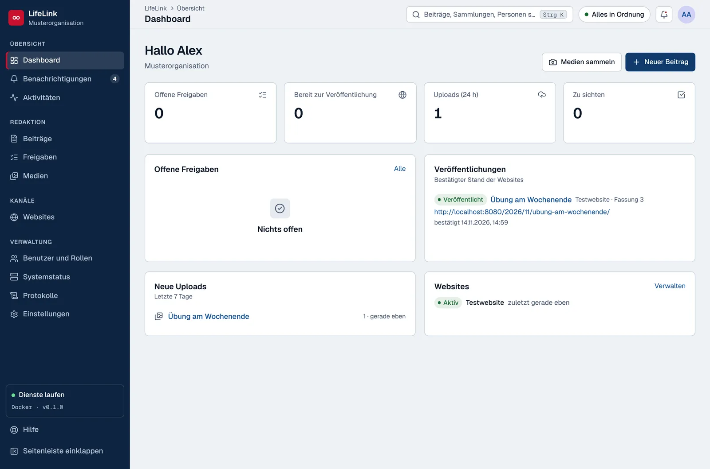

<table>
  <tr>
    <td valign="top" width="33%"><b>Beitrag mit Freigabe</b><br/><sub>Fassungen, Ziele, Veröffentlichungen</sub><br/><br/></td>
    <td valign="top" width="33%"><b>Freigaben</b><br/><sub>eine Liste für alle Arten</sub><br/><br/>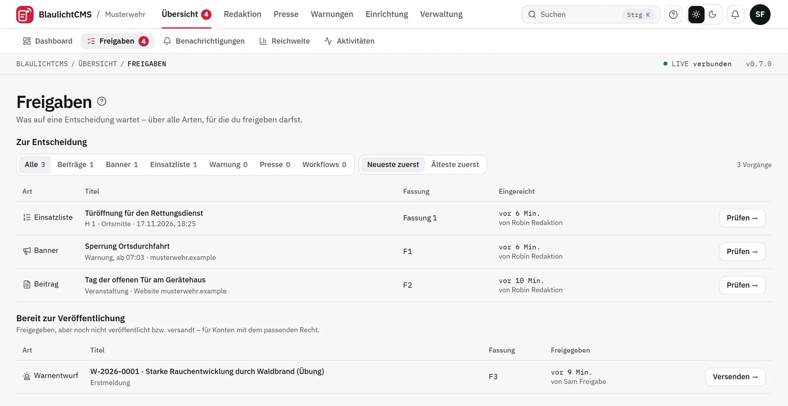</td>
    <td valign="top" width="33%"><b>Kalender</b><br/><sub>Termine, Serien, geplante Beiträge</sub><br/><br/></td>
  </tr>
  <tr>
    <td valign="top"><b>Presseanfragen</b><br/><sub>Status, Zuständigkeit, Frist, Verlauf</sub><br/><br/></td>
    <td valign="top"><b>Bild aus Vorlage</b><br/><sub>ausfüllen mit Live-Vorschau</sub><br/><br/></td>
    <td valign="top"><b>Reichweite</b><br/><sub>je Netzwerk, nur Summen</sub><br/><br/>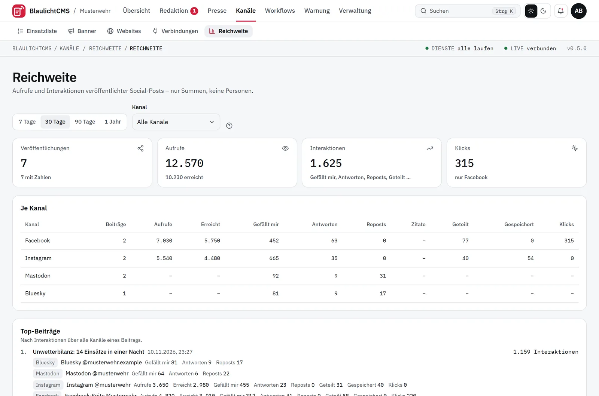</td>
  </tr>
</table>

<br/>

## Idee

In der Öffentlichkeitsarbeit von Feuerwehr, Rettungsdienst und Katastrophenschutz passiert viel gleichzeitig: Fotos
liegen verstreut auf privaten Handys und in Messenger-Gruppen, derselbe Text wird für Website, Facebook und Instagram
mehrfach getippt, Freigaben laufen per Zuruf – und bei Unwetter oder Großeinsatz muss es schnell gehen.

BlaulichtCMS bringt das an einen Ort, mit einem festen Ablauf:

<picture>
  <source media="(prefers-color-scheme: dark)" srcset="docs/grafik/ablauf-dunkel.svg">
  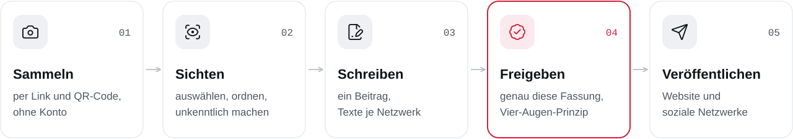
</picture>

<br/><br/>

- **Ein Ablauf statt vieler Werkzeuge** – vom Foto bis zum veröffentlichten Beitrag in einer Anwendung.
- **Freigabe genau einer Fassung** – veröffentlicht wird nur, was freigegeben wurde; jede spätere Änderung braucht eine
  neue Freigabe.
- **Der Mensch entscheidet** – Workflows und Assistenten bereiten vor, entschieden wird von Menschen.
- **Für unterwegs gebaut** – Hochladen ohne Konto, Sichten und Freigeben am Handy.
- **Auf dem eigenen Server** – selbst gehostet und quelloffen, ohne Abhängigkeit von einem Anbieter.

<table>
  <tr>
    <td valign="top" width="33%" align="center"><b>Hochladen</b><br/><sub>ohne Konto, Fortschritt je Datei</sub><br/><br/>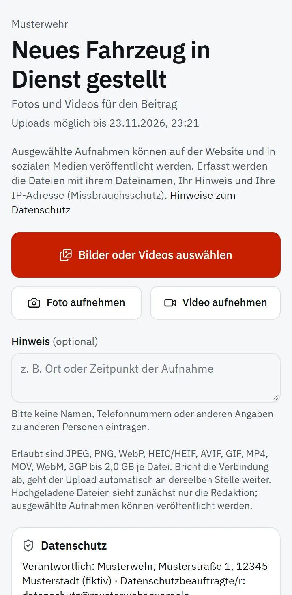</td>
    <td valign="top" width="33%" align="center"><b>Sichten</b><br/><sub>auswählen, zurückstellen, überspringen</sub><br/><br/></td>
    <td valign="top" width="33%" align="center"><b>Beitrag</b><br/><sub>nächster Schritt, Status, bestätigte URL</sub><br/><br/></td>
  </tr>
</table>

<br/>

## Schnittstellen

BlaulichtCMS verbindet sich mit den Systemen, die im Alltag schon da sind. Jede Verbindung durchläuft denselben Weg:
**Verbinden → Testen → Vorschau → Aktivieren**.

<picture>
  <source media="(prefers-color-scheme: dark)" srcset="docs/grafik/schnittstellen-dunkel.svg">
  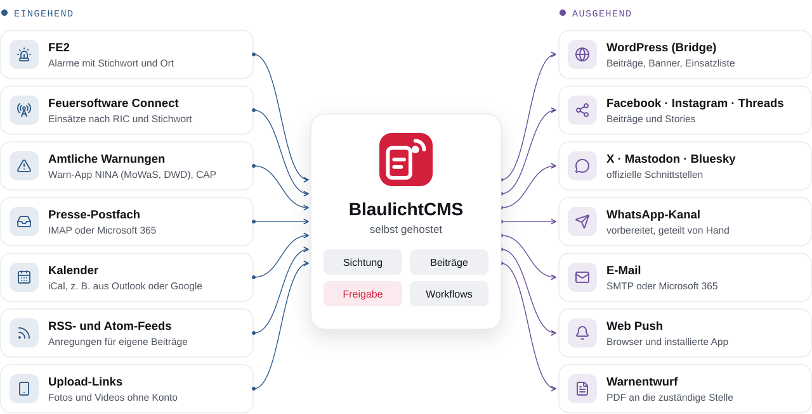
</picture>

<br/><br/>

| Schnittstelle | Richtung | Wofür |
|---|---|---|
| **FE2** | eingehend | Alarm wird zum internen Beitragsentwurf und kann Workflows auslösen |
| **Feuersoftware Connect** | eingehend | regelmäßiger Abruf der Einsätze, Filter nach RIC und Stichwort |
| **Amtliche Warnungen** | eingehend | Warn-App-Schnittstelle des Bundes (NINA) nach Regionalschlüssel oder CAP-Feeds |
| **Presse-Postfach** | eingehend | IMAP oder Microsoft 365 – neue Mails werden Presseanfragen |
| **Kalender** | ein- und ausgehend | iCal-Quellen einlesen, persönliches iCal-Abo für Outlook, Google und iPhone |
| **RSS- und Atom-Feeds** | eingehend | Anregungen für Beiträge und Auslöser für Workflows |
| **WordPress** | ausgehend | Plugin BlaulichtCMS Bridge: Beiträge, Banner, Einsatzliste mit Jahresstatistik |
| **Facebook, Instagram, Threads** | ausgehend | Beiträge und Stories über die offiziellen Schnittstellen, Reichweite |
| **X, Mastodon, Bluesky** | ausgehend | über die offiziellen Schnittstellen, X wahlweise von Hand |
| **WhatsApp-Kanal** | ausgehend | Text und Bilder vorbereitet, Teilen von Hand |
| **E-Mail** | ausgehend | SMTP oder Microsoft 365: Antworten, Pressemitteilungen, Benachrichtigungen |
| **Web Push** | ausgehend | Mitteilungen an Browser und installierte App |
| **Warnentwurf** | ausgehend | PDF an die zuständige Stelle für die MoWaS-Auslösung |
| **SMB-Freigabe oder WebDAV** | ausgehend | Sicherung außer Haus, z. B. auf einen Windows-Server oder ein NAS |

Vorschläge für weitere Schnittstellen gern als [Issue](https://github.com/thisislennard/BlaulichtCMS/issues).

<table>
  <tr>
    <td valign="top" width="50%"><b>Auf der Website</b><br/><sub>veröffentlicht über die BlaulichtCMS Bridge</sub><br/><br/>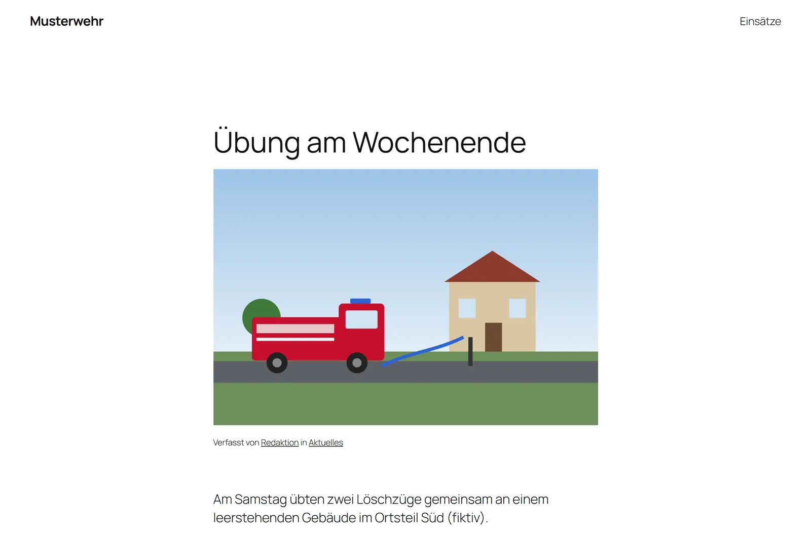</td>
    <td valign="top" width="50%"><b>Einsatzliste auf der Website</b><br/><sub>mit Jahresstatistik, freigegeben in BlaulichtCMS</sub><br/><br/>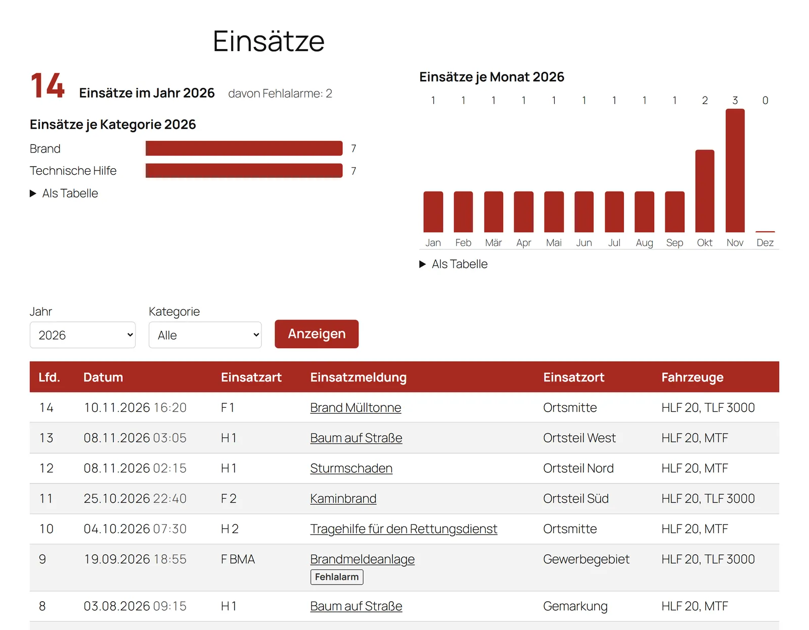</td>
  </tr>
</table>

<br/>

## Workflows

Workflows verbinden Schnittstellen und Module, ganz ohne Programmieren. Jeder Workflow hat drei Schritte und liest
sich als ein Satz:

<picture>
  <source media="(prefers-color-scheme: dark)" srcset="docs/grafik/workflow-dunkel.svg">
  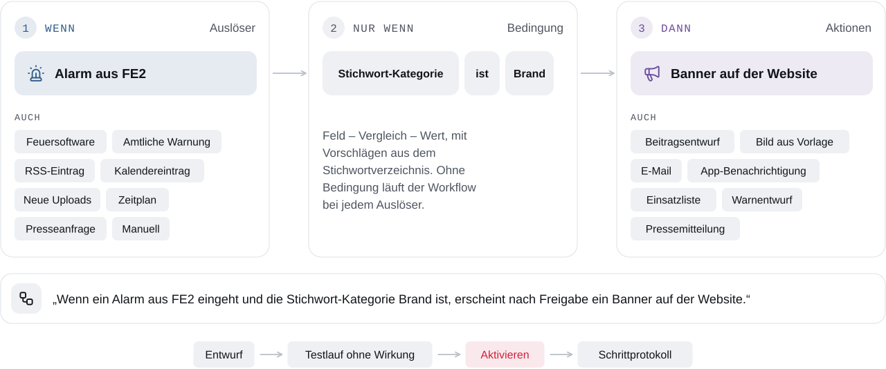
</picture>

<br/><br/>

- **Vorlagen zum Start** – z. B. „Alarm → Banner auf der Website“, „DWD-Warnung → Banner und Beitragsentwurf“ oder
  „Übung im Kalender → Banner ‚Achtung Übung‘“; jede Vorlage nennt vorher, was sie braucht.
- **Geführt oder visuell** – drei Schritte für den Alltag, ein visueller Editor mit Verzweigung, Warten, Freigabe und
  Bild aus Vorlage für komplexere Abläufe.
- **Banner folgt dem Vorgang** – eine Aktualisierung der Warnung ändert das Banner, die Entwarnung beendet es.
- **Erst testen, dann aktivieren** – Testlauf ohne Wirkung, Versionen und Schrittprotokoll.
- **Teilen und mit KI erstellen** – Export und Import als JSON, dazu eine Formatbeschreibung für KI-Assistenten.

<table>
  <tr>
    <td valign="top" width="50%"><b>Geführte Ansicht</b><br/><sub>Wenn – Nur wenn – Dann</sub><br/><br/>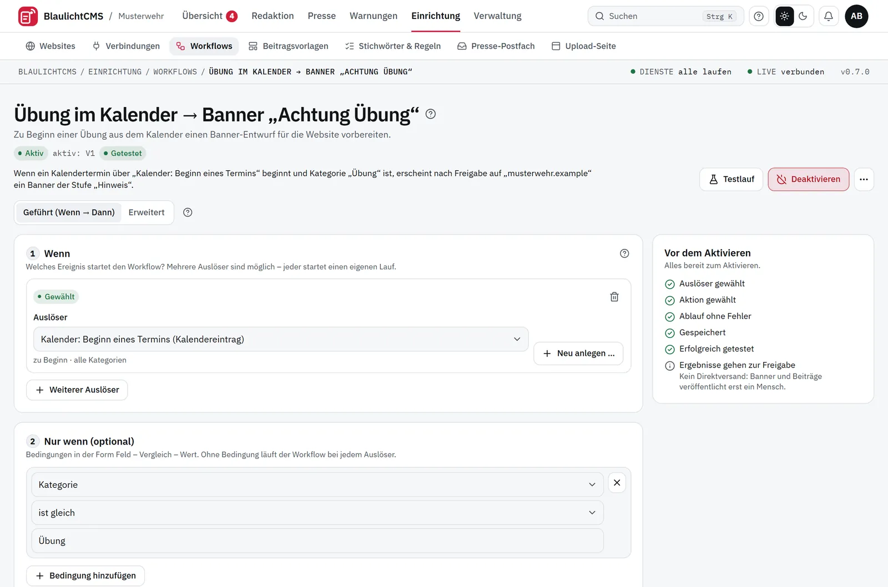</td>
    <td valign="top" width="50%"><b>Banner aus Workflows</b><br/><sub>folgen der amtlichen Warnung bis zur Entwarnung</sub><br/><br/>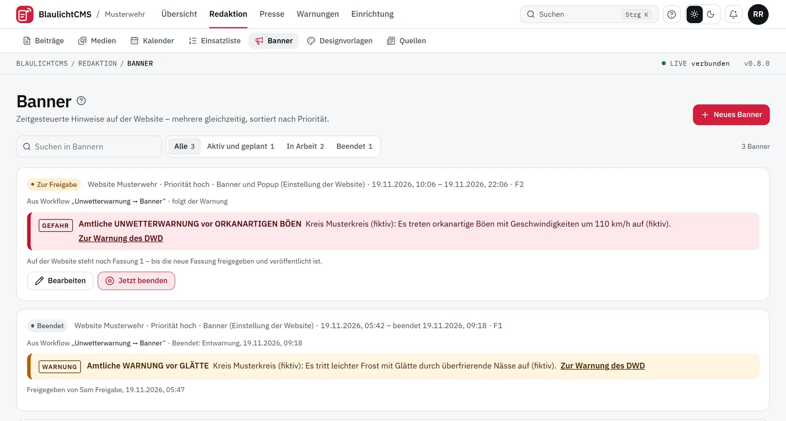</td>
  </tr>
</table>

<br/>

## Technische Umsetzung

<picture>
  <source media="(prefers-color-scheme: dark)" srcset="docs/grafik/aufbau-dunkel.svg">
  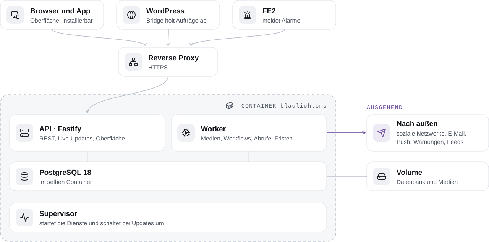
</picture>

<br/><br/>


| Baustein | Technik |
|---|---|
| **Server** | TypeScript, Node.js, Fastify; Worker für Medien (sharp, ffmpeg, lokale Gesichtsvorschläge), Workflows, Abrufe und Fristen |
| **Datenbank** | PostgreSQL 18 im selben Container |
| **Oberfläche** | React 19, Vite, Tailwind, TanStack Query; installierbare App (PWA) mit Live-Aktualisierung |
| **WordPress** | Plugin BlaulichtCMS Bridge (PHP) |
| **Betrieb** | ein Container, ein Volume, ein Port; Updates direkt aus der App mit Sicherung vorab und automatischem Rückweg |
| **Qualität** | Server-Tests gegen echtes PostgreSQL, Browsertests der Kernabläufe, Image-Updates mit echtem Docker in der CI |

**Datenschutz und Sicherheit:** DSGVO-konform und nach BSI IT-Grundschutz geprüft.

### Installation

Auf einem Linux-Server mit Docker:

```bash
curl -fsSL https://raw.githubusercontent.com/thisislennard/BlaulichtCMS/main/install.sh -o install.sh
sudo bash install.sh
```

Das Skript führt durch die Einrichtung und zeigt am Ende den Schlüssel für die Ersteinrichtung im Browser.
Ausführlich: [Installation und Betrieb](docs/installation.md) · [Technischer Aufbau](docs/technik.md)

<br/>

---

<div align="center">
<sub>
<a href="LICENSE">GPL-3.0-or-later</a> · WordPress-Plugin BlaulichtCMS Bridge unter GPL-2.0-or-later ·
<a href="CONTRIBUTING.md">Mitmachen</a>
</sub>
</div>
