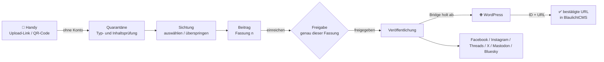
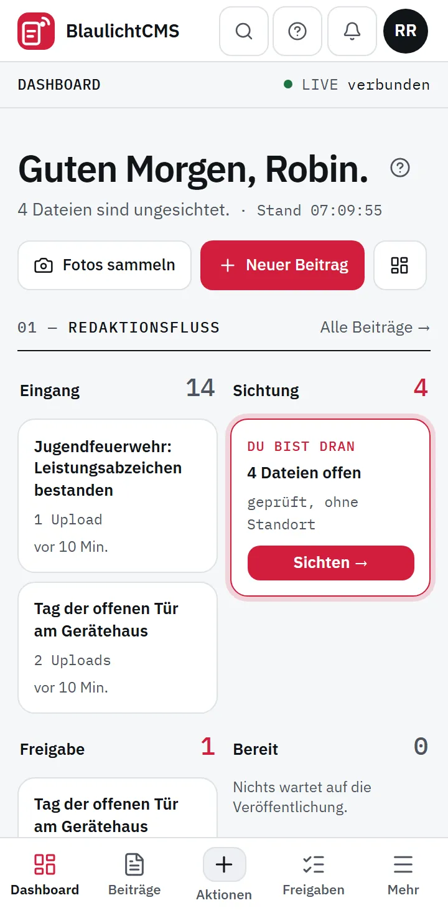
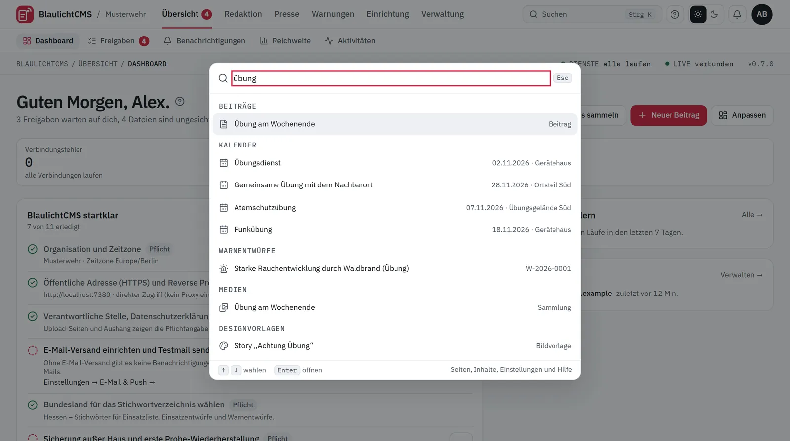
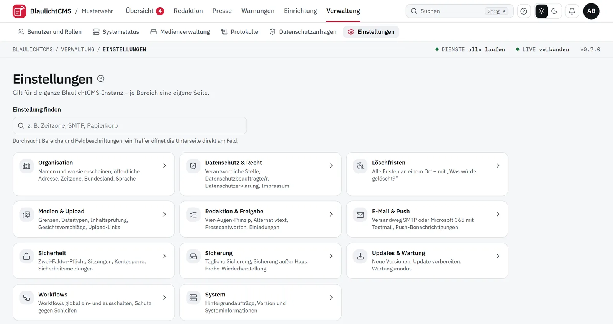
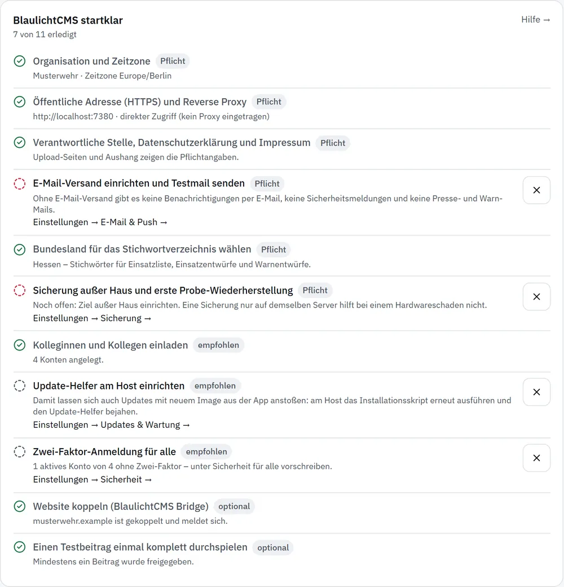
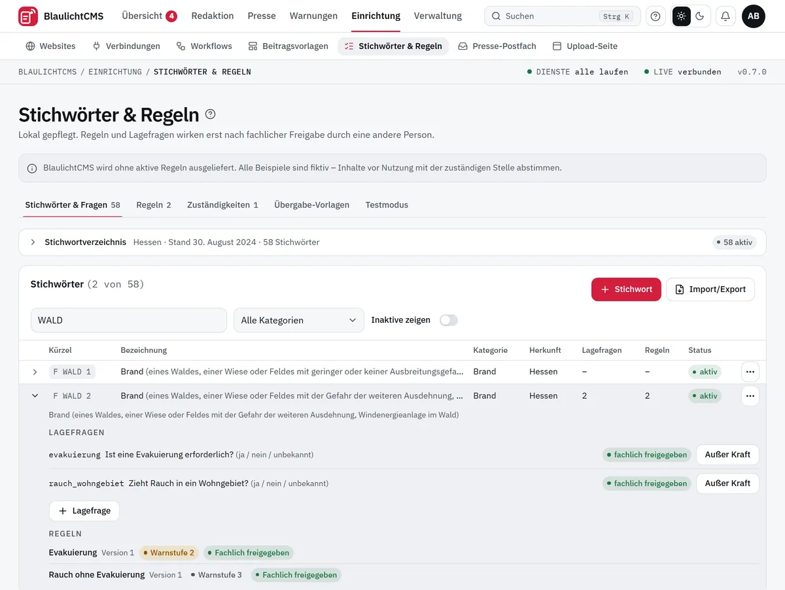
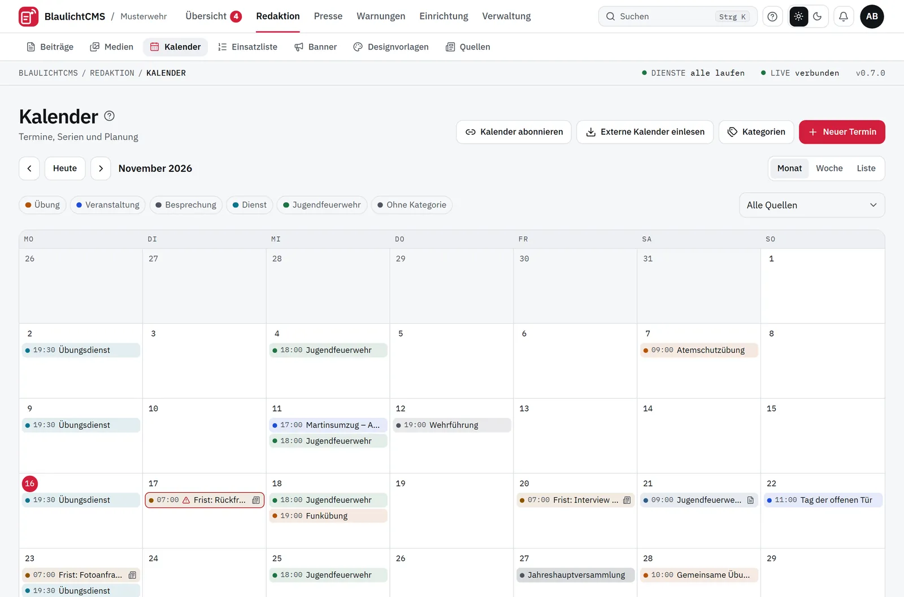
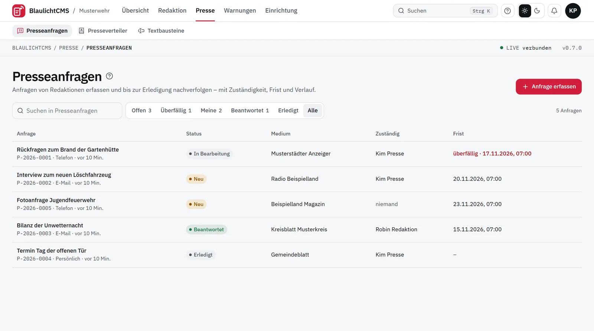
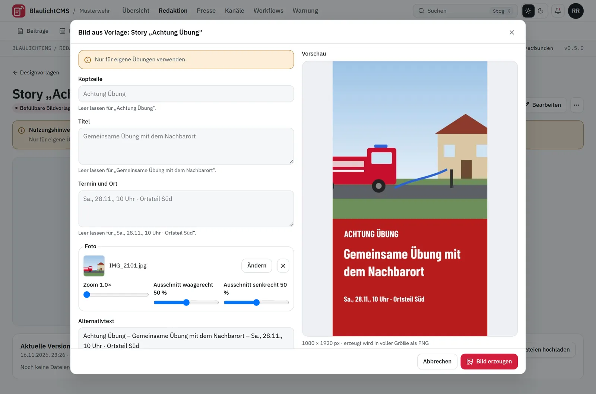

<div align="center">

# BlaulichtCMS

**Selbst gehostetes Redaktionssystem für Öffentlichkeitsarbeit und Krisenkommunikation**

Fotos per Link vom Handy sammeln · sichten · Beiträge schreiben · Fassung freigeben · auf Website und sozialen Netzwerken veröffentlichen – dazu Kalender, Presseanfragen, Einsatzliste und Workflows, nachvollziehbar und auf dem eigenen Server

[](https://github.com/thisislennard/BlaulichtCMS/actions/workflows/ci.yml)
[](https://github.com/thisislennard/BlaulichtCMS/actions/workflows/security.yml)
[](LICENSE)


</div>


> [!NOTE]
> **Version 0.7.0 – noch vor dem ersten Produktivbetrieb.** Der Funktionsumfang ist vollständig und automatisiert
> getestet; was mit echten Fremdsystemen geprüft ist und was noch nicht, steht unter
> [Teststand und Grenzen](docs/technik.md#teststand-und-grenzen). Alle Screenshots stammen aus einer Testinstanz mit fiktiven Daten.

---

## Inhalt

- [Funktionen](#funktionen)
- [Einblicke](#einblicke)
- [Schnellstart](#schnellstart)
- [Dokumentation](#dokumentation)
- [Mitmachen und Lizenz](#mitmachen-und-lizenz)

---

## Funktionen



### Fotos und Videos sammeln

- **Upload-Link (Fotos sammeln):** Mit einem Klick entsteht eine Sammlung mit befristetem, jederzeit widerrufbarem Upload-Link – als Link
  zum Teilen (auch per WhatsApp oder E-Mail), als QR-Code (PNG/SVG) oder als A4-Aushang zum Drucken. Wer hochlädt,
  braucht kein Konto.
- **Links bedienen:** Gültigkeit in Stunden, Tagen oder bis zu einem Termin; pausieren, fortsetzen, verlängern, neu
  erzeugen (alter Link und QR-Code sofort ungültig), eigener Begrüßungstext je Link.
- **Optionen je Link:** Grenzen (Uploads, Dateien je Upload, Größe), erlaubte Dateitypen, abgefragte Angaben (Name,
  E-Mail, Ort, Datum – je aus, freiwillig oder Pflicht, mit Löschfrist), Bestätigung vor dem Upload, optional Passwort.
- **Upload-Seite gestalten** (Einrichtung → Upload-Seite): Titelbild, Logo, Überschriften, Texte, Bilder mit Unterschrift, Hinweisboxen,
  Akzentfarbe mit gutem Kontrast, Platzhalter {thema}/{datum}, Live-Vorschau für Handy und Rechner – als Standard und
  je Link; der Datenschutzabschnitt bleibt immer dabei.
- **Upload am Handy:** großer Knopf für die Galerie, „Foto aufnehmen“ und „Video aufnehmen“ für die Kamera, mehrere
  Dateien auf einmal, Fortschritt je Datei, unterbrochene Uploads werden fortgesetzt
  (auch große Videos), Vorgangsnummer für Rückfragen, Hinweis für das Team im Feld.
- **Formate:** JPEG, PNG, WebP, HEIC, AVIF, GIF (animiert nur auf Wunsch), MP4, MOV, WebM, 3GP – global und je Link
  einschränkbar.
- **Sicher eingesammelt:** Quarantäne, Prüfung von Dateityp und Inhalt (Videos werden dekodiert), optional Virenscan (ClamAV), Größen- und
  Mengengrenzen je Link und Sammlung, Schutz vor Überlastung; auffällige Dateien werden gesperrt statt gelöscht
  (erneut prüfen, bei Videos mit reinem Dekodierbefund trotzdem freigeben), Sicherheitsereignisse der Upload-Seiten
  ohne Klar-IP, drittes Recht „Medien administrieren“.
- **Datenschutz von Anfang an:** Datenschutzinformation auf der Upload-Seite, Standort- und Kameradaten werden
  entfernt – in der öffentlichen Fassung und auf Wunsch auch im Original.

### Sichten und aufbereiten

- **Sichtung am Handy oder Laptop:** Datei für Datei auswählen, überspringen oder zurückstellen – per Button,
  Wischgeste oder Tastatur – die Knöpfe stehen fest unten im Fenster, am Rechner Vorschau und Angaben nebeneinander;
  offene fortsetzen, alle erneut oder nur ausgewählte durchsehen; das nächste Bild ist schon geladen, gleichzeitiges
  Sichten wird erkannt.
- **Galerie:** Kacheln oder Liste mit Seiten, Großansicht zum Blättern, Details je Datei mit Anzeigename,
  Beschreibung, interner Notiz, Prüfsumme und Duplikat-Hinweis, Mehrfachauswahl mit Sammelaktionen.
- **Ordnen:** Ordner (beliebig tief) in jeder Sammlung, Zielordner je Upload-Link, Verschieben und Kopieren zwischen
  Sammlungen (Beiträge bleiben gültig), Schlagworte, Titelbild und Veranstaltungsdatum, Suche über alle Dateien.
- **Papierkorb:** gelöschte Dateien, Ordner und Sammlungen bleiben bis zur Frist wiederherstellbar; endgültig löscht
  nur, wer „Medien administrieren“ hat, oder die Löschfrist.
- **Benachrichtigungen:** neue Dateien über Upload-Links (gebündelt), Link läuft bald ab, Kontingent erreicht,
  Speicher knapp – je Person abschaltbar.
- **Speicherübersicht:** Verbrauch je Sammlung, Ordner und Art, Papierkorb, Quarantäne und ZIP-Downloads, freier Platz
  mit Warnschwelle; Frist und Höchstgröße der ZIP-Downloads einstellbar.
- **Abgebildete Personen:** Markierungen für erkennbare Personen, Verletzte, Kennzeichen und sensible Inhalte;
  markierte Medien verlangen vor der Freigabe eine bewusste Datenschutz-Prüfung – bei Beiträgen, in der Einsatzliste
  und bei Bildern aus Vorlagen (sie erben die Markierungen ihrer Quellbilder).
- **Unkenntlich machen:** Bereiche verpixeln, weichzeichnen oder abdecken, Kennzeichen mit einem Klick (Werkzeug „Kennzeichen anklicken“: Bereich in Kennzeichenform, Größe wählbar), Bilder zuschneiden, Videos ohne Ton
  veröffentlichen – das Original bleibt unverändert.
- **Gesichter automatisch vorschlagen:** lokale Gesichtssuche (YuNet, MIT) schlägt Bereiche zum Unkenntlichmachen vor –
  einzeln oder alle übernehmen bzw. verwerfen; nichts wird ohne Bestätigung unkenntlich, offene Vorschläge verlangen
  die Datenschutz-Prüfung bei der Freigabe. Keine Wiedererkennung, nur Rechtecke; Kennzeichen (ein Klick je Kennzeichen) und Videos bleiben Handarbeit.
- **Herunterladen:** einzelne Dateien oder als ZIP (ausgewählte, markierte, ein Ordner oder sammlungsübergreifend) mit
  Ordnerstruktur und optional `metadaten.csv`; Originale nur mit dem Recht „Originale herunterladen“.

### Beiträge schreiben

- **Beitragsarten:** Nachricht, Einsatzbericht, Veranstaltung, Lage-Info – mit Vorlagen für wiederkehrende Texte.
- **Fassungen:** Jede Änderung an Text, Medien oder Veröffentlichungszielen erzeugt eine neue Fassung; Unterschiede sind
  nachvollziehbar.
- **Texte je Netzwerk:** eigener Text für Website, Facebook, Instagram, Threads, X, Mastodon, Bluesky und WhatsApp-Kanal,
  Vorschau je Netzwerk mit genau dem gesendeten (ggf. gekürzten) Text, Story-Vorschau und Zeichenzähler, geplanter
  Veröffentlichungstermin.
- **Geführt zum Einreichen:** „Nächster Schritt“ zeigt den Weg Text → Medien (Sichtung, Übernahme) → Alternativtexte →
  Ziele → Einreichen; vor dem Einreichen eine Prüfliste aus denselben Prüfungen wie Freigabe und Veröffentlichen
  (Ziele, Titelbild, Alternativtexte, Datenschutz-Prüfung, Formate und Zeichengrenzen je Netzwerk); Speichern-Leiste
  auf allen Bildschirmgrößen.
- **Barrierefreiheit:** Alternativtext je Bild (in der Medienverwaltung hinterlegt und wiederverwendet, an Website
  und soziale Netzwerke übergeben), Freigabe mit Warnung oder Pflicht; Lesbarkeitshinweis im Editor mit
  Flesch-Amstad und Wiener Sachtextformel, langen Sätzen, Abkürzungen, Linktexten wie „hier“ und Hashtags – ohne KI.
- **Quellen:** RSS- und Atom-Feeds als Anregung für eigene Beiträge.
- **Kalender:** eigene Termine und Serien (täglich, wöchentlich, monatlich auch „jeden 1. Samstag“, jährlich; Ende nach
  Datum oder Anzahl, einzelne Termine ändern oder auslassen), Kategorien mit Farben, Ansichten Monat, Woche und Liste
  (am Handy Liste), Filter nach Kategorie und Quelle; in der eingestellten Zeitzone inklusive Sommer-/Winterzeit. Geplante
  Beiträge mit Status und Veröffentlichungszielen erscheinen im Kalender und lassen sich per Ziehen (oder Datum/Uhrzeit) verschieben –
  mit Hinweis und neuer Freigabe, wenn der Termin zur freigegebenen Fassung gehört; Fristen von Presseanfragen,
  überfällige hervorgehoben. Externe Kalender (iCal: Outlook, Google, Wehr-Kalender) einlesen – mit Verbindungstest,
  Abrufintervall, Kategorie je Quelle, Empfangsprotokoll, verschlüsselt gespeicherter Adresse; persönlicher, geheimer
  iCal-Abo-Link (nur Titel/Zeit/Kategorie, wählbare Kategorien) für Outlook, Google und iPhone. Workflow-Auslöser
  „Kalendereintrag“: Termine lösen zu Beginn, zum Ende oder X vorher Workflows aus (z. B. Übung → Banner „Achtung Übung“).

### Designvorlagen

- **Interne Bibliothek:** Logos, Layouts und Vorlagen mit Kategorien, Vorschaubild, Schlagworten, Suche und Filtern –
  nur für angemeldete Personen.
- **Mehrere Formate und Versionen:** PNG, SVG, PDF und offene Dateien je Vorlage; neue Versionen hochladen, ältere bleiben
  abrufbar. Nutzungshinweis je Vorlage und Download-Zähler.
- **Befüllbare Bildvorlagen:** Layout mit Textfeldern (automatischer Umbruch und Verkleinerung), Bild-Platzhaltern mit
  Zuschnitt, Logo und Flächen im Editor (Maus und Tastatur), Formate für Feed, Story und Link-Vorschau; Ausfüllen mit
  Live-Vorschau, das Bild landet geprüft in den Medien – auch direkt im Beitragseditor („Bild aus Vorlage“).
- **Schriften:** freie Schriften (SIL OFL) mitgeliefert, eigene TTF/OTF mit Lizenzhinweis hochladbar.
- **In Workflows:** Baustein „Bild aus Vorlage erzeugen“ mit Platzhaltern; das Bild geht an Beitrag, Social und Story,
  der Testlauf zeigt eine Vorschau.
- **Sicher:** Inhalt muss zur Endung passen, SVG wird bereinigt (keine Skripte, keine externen Verweise), optional
  ClamAV-Prüfung.

### Freigeben

- **Freigabe genau einer Fassung** (Prüfsumme) – ändert sich danach etwas, ist eine neue Freigabe nötig.
- **Eine Freigaben-Liste für alle Arten:** Beiträge, Banner, Einsatzliste, Warnentwürfe, Antworten an die Presse und
  Freigaben aus Workflows an einer Stelle – nur Arten, für die das Konto freigeben darf, mit Filter nach Art und
  Sortierung; was das Vier-Augen-Prinzip sperrt, steht ausgegraut mit Grund dabei. „Prüfen →“ öffnet die Prüfansicht der
  Art; darunter Freigegebenes, das noch auf Veröffentlichung oder Versand wartet. Zähler in der Kopfzeile, Kennzahl und
  Begrüßung im Dashboard zählen alle Arten.
- **Freigabe unterwegs:** die Push-Mitteilung „Freigabe erbeten“ öffnet eine kompakte Freigabe-Ansicht fürs Handy (Vorschau je Netzwerk, Bilder, Änderungen zur letzten Fassung) mit Freigeben/Ablehnen unter denselben Regeln; in Chrome/Edge/Android mit Knöpfen in der Mitteilung, die nur die Ansicht öffnen – nie ohne Vorschau.
- **Vier-Augen-Prinzip** wählbar für Beiträge, Banner und Warnentwürfe: wer geschrieben oder eingereicht hat, gibt
  nicht selbst frei.
- **Intern freigeben** ohne Veröffentlichung, z. B. für Pressemitteilungen oder als Vorlage.

### Veröffentlichen

- **WordPress über die BlaulichtCMS Bridge:** Plugin direkt aus BlaulichtCMS, Kopplung per Einmalcode, die Website holt
  Aufträge per HTTPS ab – kein offener Eingang zur Website. WordPress-ID und URL kommen zurück; auch eine doppelte
  Abholung erzeugt nie einen zweiten Beitrag. Kategorie je Beitrag und je Workflow; Autor als eigener Autor der
  Bridge oder je Person (ohne Rechte, ohne Anmeldung). Kein Host-Cron nötig. Updates des Plugins sind signiert und
  laufen auf Wunsch automatisch.
- **Banner auf der Website:** Hinweise und Gefahrenmeldungen mit Laufzeit, automatisch am Seitenanfang oder per Block
  bzw. Shortcode; abgelaufene Banner verschwinden auch aus zwischengespeicherten Seiten. Farbe und Darstellung je
  Schweregrad (Banner, barrierearmes Popup beim Aufruf der Seite oder beides) stellt die Website ein.
- **Einsatzliste mit Jahresstatistik** auf der Website: Einsätze aus FE2/Feuersoftware-Alarmen vorschlagen, per Workflow
  „Einsatz in Einsatzliste“ oder von Hand anlegen, CSV-Import (auch aus der Erweiterung „Einsatzverwaltung“), Freigabe
  genau dieser Fassung, Veröffentlichen und Zurückziehen. Ort nur auf Ortsteil-Ebene (Allowlist). In WordPress
  einstellbar: Spalten, Sortierung, Filter, Tabelle oder Karten, Jahresabschnitte, Detailseiten, Kategorienfarben und
  -symbole; Statistik je Jahr, Monat und Kategorie mit Diagramm – auch in einzelnen Teilen (z. B. nur die große Zahl
  auf der Startseite). Alle Shortcodes mit Attributen und Beispielen zum Kopieren erklärt das Plugin selbst.
- **Einsatzübersicht** auf der Website per Shortcode bzw. Block.
- **Facebook und Instagram:** Veröffentlichung je Netzwerk mit eigenem Status, wahlweise als Beitrag, **Story** oder
  beides (Bilder automatisch auf 9:16); Facebook-Beiträge lassen sich wieder löschen, für Instagram gibt es einen
  geführten Weg.
- **Threads und X:** Threads über die offizielle Threads-API; X wahlweise über die eigene (kostenpflichtige) X-API
  oder **Teilen von Hand** mit vorbereitetem Text (280 Zeichen) und Beitragsfenster von x.com.
- **Mastodon und Bluesky:** kostenlos über die offiziellen Schnittstellen – Mastodon mit frei wählbarer Instanz
  (z. B. social.bund.de), Anmeldung per OAuth oder Zugangstoken, Sichtbarkeit und Inhaltswarnung; Bluesky mit
  App-Passwort und Link-Vorschaukarte. Bilder mit Alternativtext, Löschen über die Schnittstelle.
- **WhatsApp-Kanal:** Teilen von Hand – WhatsApp hat für Kanäle keine Schnittstelle. Text mit WhatsApp-Formatierung,
  Link und Bilder sind vorbereitet; geteilte Beiträge werden als geteilt markiert.
- **Reichweite:** Aufrufe und Interaktionen der Social-Posts über die offiziellen Statistik-Schnittstellen
  (Facebook, Instagram, Threads, X nach Wahl, Mastodon, Bluesky) – nach 1 Stunde, 24 Stunden und 7 Tagen, je Beitrag,
  als Übersicht mit Top-Beiträgen und als Dashboard-Kachel; nur Summen, keine Personen.
- **Zurückziehen:** Beitrag von der Website nehmen – inklusive der übernommenen Bilder in der Mediathek.

### Warnentwurf und amtliche Warnungen

- **Warnentwurf (MoWaS-Übergabe):** Assistent in sechs Schritten für Erstmeldung, Aktualisierung und Entwarnung –
  auch am Handy.
- **Warnstufen-Assistent:** schlägt anhand lokal gepflegter, fachlich freigegebener Regeln eine Warnstufe vor oder
  sagt ehrlich „Keine eindeutige Empfehlung“; die Stufe bestätigt immer ein Mensch.
- **Freigabe und Versand:** Die Freigabe fixiert die PDF; Versand per E-Mail an die zuständige Stelle (ab Werk im
  Testmodus), Eingangsbestätigung, Umgang mit unklarer Zustellung. Die amtliche Auslösung bleibt bei der zuständigen
  Stelle.
- **Pflege:** Stichwörter mit Aliasen als kompakte Tabelle mit Suche und Filtern (Lagefragen und Regeln je Zeile
  aufklappbar), Regeln mit Versionen, Zuständigkeiten, Vorlagen – Regeln und Lagefragen gibt immer eine andere Person frei.
- **Stichwortverzeichnis je Bundesland:** amtliche Verzeichnisse für Hessen (Runderlass 2024) und Bayern (ABek-Anlage)
  wortgetreu mitgeliefert, für alle Länder eigene Liste per CSV/JSON importier- und exportierbar; Bedeutung der
  Stichworte in Einsatzmeldungen, Workflows und Filtern.
- **Amtliche Warnungen:** Warn-App-Schnittstelle des Bundes (NINA, gefiltert nach Regionalschlüssel) oder CAP-Feeds,
  auf Wunsch als Banner auf der Website mit Quellenvermerk.

### Presse

- **Presseanfragen:** von Hand erfassen (z. B. nach einem Anruf), Status neu → in Bearbeitung → beantwortet → erledigt,
  zuständige Person, Frist mit Erinnerung, Verknüpfung mit Einsatz und Beitrag, interne Notizen, mündliche Antwort
  festhalten (Telefon/vor Ort: Antwort und „beantwortet“ in einem Schritt), vollständiger Verlauf,
  Übersicht mit Filtern und Dashboard-Kachel; Löschfrist Standard 12 Monate nach Erledigung bzw. – für nie erledigte
  Anfragen – nach der letzten Aktivität, mit Ankündigung 30 Tage vorher; Workflow-Auslöser
  „Neue Presseanfrage“ ohne Kontaktdaten.
- **Presse-Postfach:** Abruf per IMAP (TLS/STARTTLS) oder Microsoft 365 (Graph, gleiche App-Registrierung wie der
  Mailversand) – rein lesend, Verbindungstest vor Aktivierung, Passwort verschlüsselt; neue Mails werden Anfragen,
  Antworten im Mail-Verlauf werden zugeordnet, automatische Antworten/Spam/Newsletter ignoriert, Anhänge mit
  Größenlimit und Typprüfung, HTML entschärft, Empfangsprotokoll; Abruf je Mail mit gespeichertem Stand – eine
  fehlerhafte Mail wird als „nicht übernommen“ protokolliert und hält den Abruf nie auf.
- **Antworten aus BlaulichtCMS:** Antwort-Editor in der Anfrage, Versand über SMTP oder Microsoft 365 mit richtigen
  Kopfzeilen für den Mail-Verlauf, Textbausteine mit Platzhaltern, optionale Freigabe durch eine zweite Person
  (Standard aus), Status automatisch „beantwortet“, nie automatischer Doppelversand.
- **Presseverteiler und Pressemitteilungen:** Kontakte von Redaktionen mit Pflichtangaben zu Herkunft und
  Rechtsgrundlage (Einwilligung mit Datum), Verteilerlisten, CSV-Import/-Export, Wiedervorlage „zu prüfen“, nach der
  Abmeldung nur Sperrvermerk; Pressemitteilung frei oder aus einem Beitrag an Listen senden – jede Mail einzeln
  adressiert, Fußzeile mit verantwortlicher Stelle, Datenschutzhinweis und Abmeldelink (auch Ein-Klick),
  Versandprotokoll je Empfänger mit Löschfrist; Workflow-Aktion „Pressemitteilung an Verteiler“
  (Standard Entwurf, Direktversand nur mit den bestehenden Absicherungen).

### Verbindungen

- **Nach Richtung geordnet:** „Eingehend“ (FE2, Feuersoftware Connect, amtliche Warnungen) und „Veröffentlichen“
  (Websites und soziale Netzwerke) – in der Liste wie im Dialog „Neue Verbindung“, ohne Vorauswahl und mit
  vorgeschlagenem Namen; gekoppelte Websites stehen mit Verweis auf ihre Seite dabei.
- **FE2 und Feuersoftware Connect:** Einsätze erzeugen je Einsatz einen internen Beitragsentwurf (nur freigegebene
  Felder, keine Adressen). FE2 meldet per HTTP-Aufruf, Feuersoftware Connect wird regelmäßig abgefragt (Filter nach
  RIC und Stichwort, Rücksicht auf das Abfragelimit).
- **Einheitlicher Ablauf** für alle Verbindungen: Verbinden → Testen → Vorschau → Aktivieren.
- **Empfangsprotokoll** für amtliche Warnungen, FE2 und Feuersoftware: jeder Abruf bzw. jede eingehende Meldung mit
  allen gelieferten Meldungen, Entscheidung samt Grund (z. B. „Gebiet passt nicht“, „RIC nicht in der Liste“) und
  Rohdaten – Einsatzdaten nur geschwärzt, 7 Tage aufbewahrt.
- **Medienimport:** einmalige Übernahme von Medien und gültigen Upload-Links aus einem Altsystem (Austauschformat,
  Exportskript für LiFeOS).

### Workflows

- **Vorlagen:** „Alarm → Banner auf der Website“, „DWD-Warnung → Banner + Beitragsentwurf“, „Alarm mit
  Stichwort-Kategorie Brand → Beitragsentwurf“, „Warnung → Benachrichtigen“, „Übung im Kalender → Banner
  ‚Achtung Übung‘“, „Kalendertermin Übung → Story-Bild + Banner“, „Termin von Hand → Story-Bild + Beitragsentwurf“
  oder leer beginnen; passende Auslöser und Aktionen werden eingesetzt, offene Plätze hervorgehoben. Jede Vorlage
  nennt vor dem Anlegen ihre Voraussetzungen (z. B. FE2-Verbindung, Website, Bildvorlage) mit Stand und Weg zum
  Einrichten; einsatzbereite Vorlagen stehen zuerst.
- **Geführt in drei Schritten:** *Wenn* (Auslöser) – *Nur wenn* (Feld – Vergleich – Wert, mit Vorschlägen aus dem
  Stichwortverzeichnis) – *Dann* (Aktionen). Fehlende Auslöser und Aktionen direkt im Workflow anlegen. Jeder Workflow
  steht in der Liste und im Editor als ein Satz („Wenn ein neuer Alarm … eingeht, erscheint nach Freigabe auf der
  Website ein Banner …“); eine Checkliste zeigt vor dem Aktivieren, was noch fehlt.
- **Erweitert – visueller Editor:** Auslöser (FE2-Alarm, Feuersoftware-Einsatz, amtliche Warnung, RSS-Eintrag, neue Uploads,
  Zeitplan, neue Presseanfrage, Kalendereintrag, manueller Start), Verarbeitung (Bedingung, Verzweigung, Felder setzen, Warten, Einmal je Vorgang, Freigabe
  anfordern, Zusammenführen, Bild aus Vorlage erzeugen) und Aktionen (Banner, Beitrag, E-Mail, App-Benachrichtigung, Warnentwurf vorbereiten, Einsatz in Einsatzliste, Pressemitteilung an Verteiler)
  auf einer Fläche verbinden – mit Palette, Minikarte, automatischer Anordnung, Rückgängig und einer Listenansicht für
  Tastatur und Handy.
- **Auslöser und Aktionen** werden auf eigenen Seiten eingerichtet (z. B. Banner-Stil nach Warnstufe, Beitragsvorlage mit
  Texten je Netzwerk, E-Mail an Rollen oder Zuständigkeiten) und in vielen Abläufen wiederverwendet.
- **Sicher:** Abläufe sind Daten (keine Formeln, kein Code); Testlauf ohne Wirkung, aktiv nur nach erfolgreichem Test,
  Versionen, Schrittprotokoll, Grenzen je Minute, Notbremse. Aktionen legen Entwürfe an – Direktversand ohne
  Freigabe nur je Workflow mit eigenem Recht, Passwortbestätigung, Audit und Sicherheitsmeldung.
- **Export und Import:** Workflows als JSON-Datei (versioniert, ohne Kennungen und Zugangsdaten) exportieren und
  mit Vorschau und Zuordnung der Auslöser und Aktionen als Entwurf importieren.
- **Mit KI erstellen:** Formatbeschreibung als JSON-Schema, Katalog der Installation (Auslöser und Aktionen, Felder, Vergleiche,
  Bildvorlagen, Stichwortverzeichnis – ohne Zugangsdaten, Kennungen, Einsatz- oder Personendaten) und eine
  anbieterneutrale Vorlage für die Anfrage; das Ergebnis wird geprüft (Fehler mit Ort und Erwartung) und als Entwurf importiert.

### Übersicht und Bedienung

- **Verständliche Rückmeldungen:** Zeitüberschreitung, abgelaufene Sitzung (mit Rückweg), offline bzw. Server nicht
  erreichbar (mit automatischem erneutem Versuch), kein Zugriff, Seite nicht gefunden, Wartung, zu viele Versuche (mit
  Wartezeit) und unerwartete Fehler (mit Details) – jeweils mit Symbol, Erklärung und „Was tun?“.
- **Dashboard:** mitgelieferte Standardansicht je Rolle (Administration, Redaktion, Freigabe, Veröffentlichung, Presse,
  Warnrollen, Lesezugriff) ohne doppelte Kacheln; Kennzahlen und Kacheln in bis zu vier Spalten (Redaktionsfluss, Meine
  Entwürfe, Freigaben, Nächste Termine samt Presse-Fristen, Meine Presseanfragen, Warnungen, Einsatzliste, Workflows mit
  Fehlern, bestätigter Stand der Veröffentlichungen, Websites, Reichweite …); Kacheln nicht genutzter Bereiche erscheinen
  erst, wenn es dort etwas gibt. Per Drag-and-drop mit Maus, Finger oder Tastatur anpassbar, eigene Reihenfolge fürs
  Handy, Dashboard-Vorlagen für alle oder je Rolle, „Standard wiederherstellen“.
- **BlaulichtCMS startklar:** Checkliste für die Administration nach der Installation – Organisation, öffentliche Adresse
  (HTTPS, Reverse Proxy), verantwortliche Stelle, Datenschutzerklärung und Impressum, E-Mail-Versand mit Testmail,
  Bundesland, Sicherung außer Haus mit Probe-Wiederherstellung, Update-Helfer, Zwei-Faktor, Website; erkennt den Stand
  selbst, verlinkt direkt an die richtige Stelle, Punkte einzeln ausblendbar. Neue Konten sehen einmal die ersten
  Schritte ihrer Rolle.
- **Live:** neue Uploads, Freigaben und Veröffentlichungen erscheinen ohne Neuladen; Benachrichtigungen in der App
  mit Filter nach Art. Freigabe-Anfragen kommen als eine Meldung je Art (mehrere gebündelt, „14 Einträge warten auf
  Freigabe“), führen genau zum Vorgang bzw. zur gefilterten Liste und gelten nach der Entscheidung als erledigt – sie
  zählen dann bei niemandem mehr als ungelesen.
- **Glocke, Push und E-Mail:** je Person und Art in einer Tabelle wählbar (Freigabe angefordert, Entscheidung,
  Einsatz-Eingang, neue Fotos, amtliche Warnungen, Verbindungsfehler, fehlgeschlagene Workflows, Updates …) – nur Arten,
  für die das Konto Rechte hat. Push an Browser und installierte App (Web Push über den Push-Dienst des Browsers, Inhalt Ende-zu-Ende-verschlüsselt,
  kein zusätzlicher Anbieter); E-Mail über SMTP oder Microsoft 365 (Microsoft Graph als Anwendung, aktivierbar erst nach
  bestandener Testmail). Push und E-Mail tragen standardmäßig nur die Art der Benachrichtigung und einen Link –
  Stichwort, Ort oder Betreff bleiben in BlaulichtCMS, Einzelheiten lassen sich je Zustellweg (Push, E-Mail) zuschalten.
- **App für Handy und Computer:** installierbar (PWA) auf Android, iPhone/iPad und am Computer (Chrome, Edge, Safari am Mac – „Zum Dock hinzufügen“), mit eigenem Fenster, Push-Mitteilungen des Betriebssystems, Zähler ungelesener Benachrichtigungen am App-Symbol und Schnellzugriffen auf Neuer Beitrag, Fotos sammeln und Freigaben; „App installieren“ im Benutzermenü.
- **Leerzustände mit nächstem Schritt:** leere Kacheln als leise Zeile, leere Seiten mit der passenden Aktion
  (z. B. „Neuer Beitrag“, „Fotos sammeln“).
- **Einheitliche Listen:** jede Liste mit derselben Werkzeugleiste (Suche, Reiter, Filter als Chips, Trefferzahl); Suche
  und Filter stehen in der Adresse – Zurück, Lesezeichen und Links aus Benachrichtigungen zeigen dieselbe Auswahl. Die
  Beitragsliste zeigt Website und soziale Netzwerke als Ziele samt geplantem Zeitpunkt; die Einsatzliste eine Zeile je Eintrag.
- **Am Handy:** untere Leiste mit Dashboard, Beiträgen, Freigaben (je nach Recht), „＋ Aktionen“ (Fotos sammeln, Sichten,
  Neuer Beitrag, Neue Erstmeldung, Anfrage erfassen – höchstens zwei Tipps) und „Mehr“; Tabellen als Karten,
  Bedienelemente mindestens 40 × 40 px.
- **Schnell bedienbar:** Suche mit `Strg` + `K` über Seiten, Schnellaktionen, Inhalte aller Bereiche mit Leserecht,
  Einstellungen und Hilfe (Vorgangsnummern wie `P-2026-0001` springen direkt zum Vorgang); „?“ an jedem Seitentitel
  und in der Kopfzeile führt zum passenden Hilfe-Kapitel; Navigation nach Aufgaben (Übersicht, Redaktion, Presse,
  Warnungen, Einrichtung, Verwaltung) mit höchstens sieben Punkten je Bereich, frühere Adressen leiten weiter;
  verbindliche Begriffe (Glossar in der Hilfe); vollständig per Tastatur nutzbar, heller und dunkler Modus (je Konto
  unter *Mein Konto*), Design „Leitstand“ für draußen und nachts mit einem Akzent – Rot nur für die Hauptaktion und
  Handlungsbedarf.
- **Eine Zeitzone für alles:** Anzeigen und Eingaben (Listen, Verläufe, Fristen, Ablauf von Upload-Links, geplante
  Veröffentlichung, Kalender, Begrüßung, Platzhalter `{datum}`, Zeitpläne) folgen der Zeitzone unter *Einstellungen →
  Organisation* (Standard Europe/Berlin), nicht der des Geräts; Sommer-/Winterzeit automatisch.
- **Einstellungen nach Bereichen:** je Bereich eine eigene Seite (Organisation, Datenschutz & Recht, Löschfristen,
  Medien & Upload, Redaktion & Freigabe, E-Mail & Push, Sicherheit, Sicherung, Updates & Wartung, Workflows, System)
  mit einer Speichern-Leiste und Rückfrage beim Verlassen; „Einstellung finden“ springt direkt zum Feld. Alle
  Löschfristen samt Probelauf auf einer Seite, SMTP und Microsoft 365 samt Testmail an einer Stelle.
- **Formulare für alle:** eigener Fenstertitel und genau eine Hauptüberschrift je Seite; Pflichtfelder auch für Screenreader gekennzeichnet; „Speichern“ und „Anlegen“ bleiben
  bedienbar und nennen fehlende Angaben direkt am Feld; lange Formulare (Einstellungen, Beitrag, Workflow,
  Bildvorlage, Upload-Seite, Presse-Postfach) mit einer gemeinsamen Speichern-Leiste und Rückfrage beim Verlassen.
- **Hilfe-Center:** 32 Kapitel mit Volltextsuche direkt in der App.

### Benutzer und Sicherheit

- **Rollen:** Administration, Medienverwaltung, Redaktion, Freigabe, Veröffentlichung, Warnentwurf, Warnfreigabe,
  Warnversand, Lesezugriff – kombinierbar, Rechte werden bei jeder Aktion serverseitig geprüft.
- **Eigene Rollen und feine Rechte:** Rollen selbst anlegen, kopieren und anpassen; 101 Rechte je Funktion
  (ansehen, anlegen, freigeben, veröffentlichen, löschen …) in 15 Bereichen. Was jemand nicht darf, wird nicht
  angezeigt. Vergabe nur innerhalb der eigenen Rechte, Vorschau der Änderung vor dem Speichern, sofort wirksam;
  die Zwei-Faktor-Pflicht richtet sich nach den Rechten.
- **Anmeldung:** Einladung per Link, Zwei-Faktor-Anmeldung mit Wiederherstellungscodes, erneute Bestätigung für
  kritische Aktionen, Schutz vor gezieltem Aussperren; eine eingeschaltete Zwei-Faktor-Pflicht gilt sofort, auch für
  bestehende Sitzungen.
- **Gespeicherte Zugangsdaten** (Presse-Postfach, Mastodon, Bluesky, SMTP, WebDAV) gelten nur für das Ziel, für das sie
  eingegeben wurden; Abrufe (Feeds, Kalender-Abos, Presse-Postfach, Updates) gehen an interne Server nur nach Freigabe
  unter *Einstellungen → Sicherheit*.
- **Nachvollziehbar:** Aktivitätsprotokoll mit Hash-Kette gegen nachträgliche Änderungen, optional an Syslog;
  Aktivitäten als lesbare Sätze, nach Modul filterbar, mit Link zum betroffenen Objekt; Alarmierung bei
  auffälligen Ereignissen.

### Datenschutz

- **Auskunft und Löschung je Person:** Suche über alle personenbezogenen Daten – auch Presse-Mails (inkl. CC und
  Anhangnamen), Versandprotokolle, Kalender, Einsatzliste und Vorlagen –, Export als ZIP mit Originalen sowie
  Presseanfragen samt Mails und Anhängen, Löschen oder Pseudonymisieren je Treffer. Ein Test stellt sicher, dass jede
  neue Tabelle mit Personenbezug abgedeckt oder begründet ausgenommen ist.
- **Löschfristen** für Sammlungen, Upload-Links, Warnvorgänge, Einsatzmeldungen (FE2, Feuersoftware Connect),
  Presseanfragen (auch nie erledigte, mit Ankündigung), Versandprotokolle der Pressemitteilungen, Aufträge der
  Einsatzliste an die Website und Protokolle – alle auf einer Seite mit Vorschau „Was würde gelöscht?“; Kontakte im
  Presseverteiler kommen nach einer Frist zur Wiedervorlage.
- **Vorlagen** für Verarbeitungsverzeichnis und Datenschutz-Folgenabschätzung mit allen Modulen, Empfängern und
  Drittlandübermittlungen (Meta, X, Bluesky, Mastodon, Microsoft 365, Push-Dienste, GitHub) und Rechtsgrundlagen zur
  Prüfung durch die oder den Datenschutzbeauftragten.
- **Datenschutzerklärung und Impressum** als eigene öffentliche Seiten (`/datenschutz`, `/impressum`), gepflegt in den
  Einstellungen mit Vorschau und neutraler Vorlage; verlinkt auf Anmeldung, Upload-Seite und in der App.

### Betrieb

- **Ein Container, ein Skript:** Das Installationsskript führt durch die Einrichtung und prüft am Ende die Adresse.
- **Updates aus der App:** neue Versionen unter *Einstellungen → Updates & Wartung*, nur mit gültiger Signatur, mit Sicherung
  vorab und automatischem Rückweg. Braucht eine Version ein neues Docker-Image, zeigt die Seite das schon bei der
  Prüfung – mit eingerichtetem **Update-Helfer** lässt sich auch dieses Update in der App anstoßen (prüft das signierte
  Release, baut, sichert, wechselt, bei Fehler zurück; Fortschritt und Protokollauszug in der App), ohne dem Container
  Zugriff auf Docker zu geben. Ohne Helfer nennt die Seite die Schritte am Host (ein Aufruf des Installationsskripts).
- **Sicherung:** täglich, verschlüsselt, auf Wunsch zusätzlich **außer Haus** auf ein NAS (WebDAV, mit Prüfsummenkontrolle und Aufbewahrung je Tag/Woche/Monat, Standard 7/4/3; Hinweis auf frühere Ziele, auf denen noch Sicherungen liegen); **Probe-Wiederherstellung** in eine Wegwerf-Datenbank auf Knopfdruck und nach Zeitplan, mit Ergebnisprotokoll im Systemstatus.
- **Systemstatus:** Dienste, Speicher, Sicherungen, Probe-Wiederherstellung, Audit-Integrität, Wartungsmodus und
  Vorabprüfung vor Updates.
- **Geprüft bei jeder Änderung:** Server-Tests gegen echtes PostgreSQL, Browsertests der Kernabläufe (Einrichtung,
  Anmeldung mit Zwei-Faktor, Beitrag bis zur Freigabe, Workflow aus Vorlage), Image-Bau und Sicherheitsprüfung;
  wöchentlich eine Versionsprüfung aller Abhängigkeiten.

---

## Einblicke

<table>
  <tr>
    <td width="33%"><b>Upload am Handy</b><br/>ohne Konto, Fortschritt je Datei<br/><br/></td>
    <td width="33%"><b>Sichtung</b><br/>Auswählen, Zurückstellen oder Überspringen<br/><br/></td>
    <td width="33%"><b>Am Handy</b><br/>untere Leiste mit Schnellaktionen<br/><br/></td>
  </tr>
  <tr>
    <td colspan="2"><b>Freigaben</b><br/>eine Liste für alle Arten, darunter Freigegebenes, das noch wartet<br/><br/></td>
    <td><b>Beitrag am Handy</b><br/>nächster Schritt, Status, bestätigte URL<br/><br/></td>
  </tr>
  <tr>
    <td colspan="2"><b>Beitrag mit Freigabe</b><br/>Fassungen, Prüfsumme, Veröffentlichungen<br/><br/></td>
    <td><b>Sammlung</b><br/>Upload-Links mit QR-Code und Aushang<br/><br/></td>
  </tr>
  <tr>
    <td><b>Suche</b><br/><code>Strg</code> + <code>K</code> über alle Bereiche<br/><br/></td>
    <td><b>Einstellungen</b><br/>je Bereich eine Seite<br/><br/></td>
    <td><b>BlaulichtCMS startklar</b><br/>Checkliste nach der Installation<br/><br/></td>
  </tr>
  <tr>
    <td><b>Auf der Website</b><br/>veröffentlicht von der BlaulichtCMS Bridge<br/><br/></td>
    <td><b>Einsatzliste auf der Website</b><br/>mit Jahresstatistik, freigegeben in BlaulichtCMS<br/><br/></td>
    <td><b>Hilfe-Center</b><br/>32 Kapitel mit Volltextsuche<br/><br/></td>
  </tr>
  <tr>
    <td><b>Warnentwurf am Handy</b><br/>Stichwort, Lagefragen, Vorschlag<br/><br/></td>
    <td><b>Freigegebene PDF</b><br/>mit bestätigter Warnstufe und Prüfsumme<br/><br/></td>
    <td><b>Stichwörter &amp; Regeln</b><br/>kompakte Tabelle, Lagefragen und Regeln je Zeile<br/><br/></td>
  </tr>
  <tr>
    <td colspan="2"><b>Workflows</b><br/>geführt in drei Schritten: Wenn – Nur wenn – Dann<br/><br/></td>
    <td><b>Kalender</b><br/>Termine, Serien, geplante Beiträge und Fristen<br/><br/></td>
  </tr>
  <tr>
    <td><b>Presseanfragen</b><br/>Status, Zuständigkeit, Frist und Verlauf<br/><br/></td>
    <td><b>Bild aus Vorlage</b><br/>ausfüllen mit Live-Vorschau<br/><br/></td>
    <td><b>Reichweite</b><br/>Aufrufe und Interaktionen je Netzwerk, nur Summen<br/><br/></td>
  </tr>
</table>

---

## Schnellstart

Auf einem Linux-Server mit Docker (Docker installiert das Skript bei Bedarf mit):

```bash
curl -fsSL https://raw.githubusercontent.com/thisislennard/BlaulichtCMS/main/install.sh -o install.sh
sudo bash install.sh
```

Das Skript fragt nur die öffentliche Adresse und wo der Reverse Proxy läuft, richtet alles Weitere ein, prüft die
Adresse und zeigt am Ende den Einrichtungsschlüssel für die Ersteinrichtung im Browser. Ausführlich – Voraussetzungen,
Optionen, Updates, Sicherung, WordPress: **[Installation und Betrieb](docs/installation.md)**.

---

## Dokumentation

| Dokument | Inhalt |
|---|---|
| [docs/installation.md](docs/installation.md) | Installation, Updates, Sicherung, Wiederherstellung, erste Schritte, WordPress verbinden |
| [docs/technik.md](docs/technik.md) | Aufbau, Verbindungen, Sicherheit, Leistung, Teststand und Grenzen, Entwicklung, Projektstruktur |
| [docs/betrieb.md](docs/betrieb.md) | Start, Betriebswerte, Lasttest, Sicherung (auch außer Haus), Probe-Wiederherstellung, Wiederherstellung, Updates, Datenbankrollen, Schlüsselwechsel, Protokollierung und Sicherheitsvorfälle, Notfall |
| [docs/reverse-proxy.md](docs/reverse-proxy.md) | HTTPS mit Nginx Proxy Manager, nginx, Caddy, Traefik, HAProxy, IIS |
| [docs/integrationen.md](docs/integrationen.md) | Stand und Einrichtung je Verbindung, Ergebnisse der Live-Tests |
| [docs/import.md](docs/import.md) | einmaliger Medienimport (Austauschformat, alte Links, Exportskript für LiFeOS) |
| [docs/bridge-api.md](docs/bridge-api.md) | Schnittstelle zwischen BlaulichtCMS und der BlaulichtCMS Bridge |
| [docs/bridge-signatur.md](docs/bridge-signatur.md) | Code-Signatur der Bridge-Updates (Ed25519) |
| [docs/design-leitstand.md](docs/design-leitstand.md) | Design „Leitstand“: Farben, Schrift, Komponenten, Ausnahmen |
| [docs/architektur.md](docs/architektur.md) | Aufbau und Architekturentscheidungen |
| [docs/sicherheitspruefung.md](docs/sicherheitspruefung.md) | Ergebnis der Sicherheitsprüfung mit Nachweisen |
| [docs/datenschutz.md](docs/datenschutz.md) | Datenschutz: Datenkategorien, Empfänger, Löschfristen, TOMs, Vorlagen für Verarbeitungsverzeichnis und DSFA |
| [docs/entwicklung.md](docs/entwicklung.md) | Entwicklungsumgebung |
| Hilfe-Center in der App (`/hilfe`) | 32 Kapitel für Redaktion und Administration |

---

## Mitmachen und Lizenz

Fehlerberichte und Verbesserungsvorschläge gern als [Issue](https://github.com/thisislennard/BlaulichtCMS/issues),
Pull Requests sind willkommen – Regeln und Entwicklungsumgebung in [CONTRIBUTING.md](CONTRIBUTING.md).
**Sicherheitslücken bitte nicht öffentlich**, sondern über *Security → Report a vulnerability* melden
([SECURITY.md](SECURITY.md)).

Lizenz: [GPL-3.0-or-later](LICENSE). Das WordPress-Plugin BlaulichtCMS Bridge steht unter GPL-2.0-or-later.
