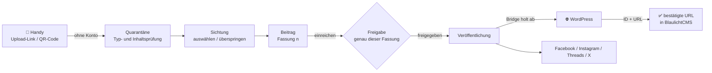
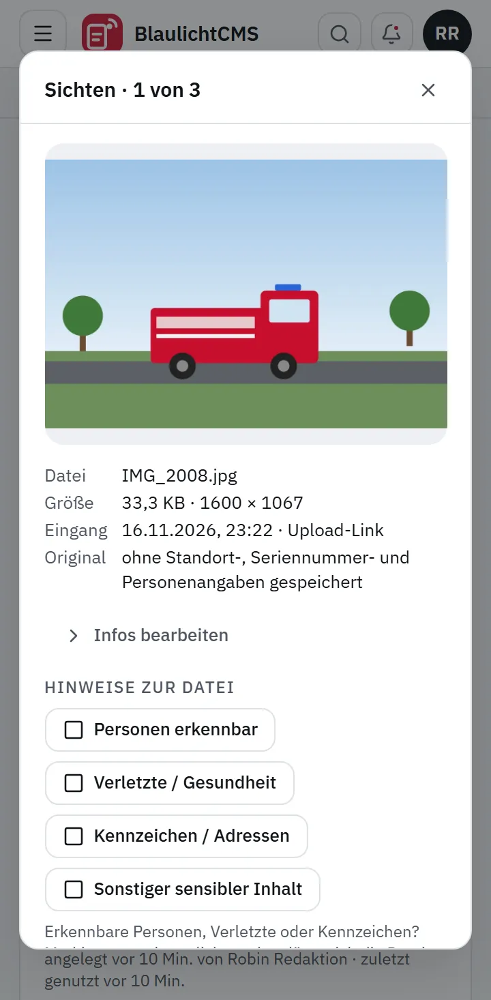
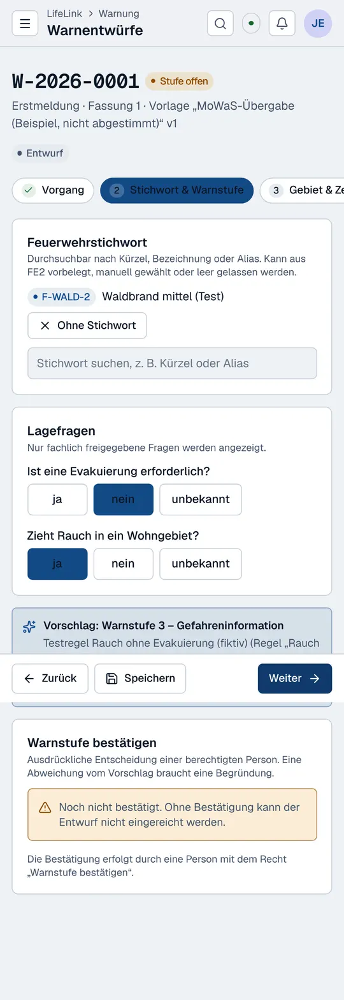

<div align="center">

# BlaulichtCMS

**Selbst gehostetes Redaktionssystem für Öffentlichkeitsarbeit und Krisenkommunikation**

Fotos per Link vom Handy sammeln · sichten · Beiträge schreiben · Fassung freigeben · auf der Website veröffentlichen – nachvollziehbar und auf dem eigenen Server

[](https://github.com/thisislennard/BlaulichtCMS/actions/workflows/ci.yml)
[](https://github.com/thisislennard/BlaulichtCMS/actions/workflows/security.yml)
[](LICENSE)


</div>


> [!NOTE]
> **Version 0.4.1 – noch vor dem ersten Produktivbetrieb.** Der Funktionsumfang ist vollständig und automatisiert
> getestet; was mit echten Fremdsystemen geprüft ist und was noch nicht, steht unter
> [Teststand und Grenzen](docs/technik.md#teststand-und-grenzen). Alle Screenshots stammen aus einer Testinstanz mit fiktiven Daten.

---

## Inhalt

- [Funktionen](#funktionen)
- [Einblicke](#einblicke)
- [Schnellstart](#schnellstart)
- [Dokumentation](#dokumentation)
- [Mitmachen und Lizenz](#mitmachen-und-lizenz)

---

## Funktionen



### Fotos und Videos sammeln

- **Foto-Link:** Mit einem Klick entsteht eine Sammlung mit befristetem, jederzeit widerrufbarem Upload-Link – als Link
  zum Teilen (auch per WhatsApp oder E-Mail), als QR-Code (PNG/SVG) oder als A4-Aushang zum Drucken. Wer hochlädt,
  braucht kein Konto.
- **Links bedienen:** Gültigkeit in Stunden, Tagen oder bis zu einem Termin; pausieren, fortsetzen, verlängern, neu
  erzeugen (alter Link und QR-Code sofort ungültig), eigener Begrüßungstext je Link.
- **Optionen je Link:** Grenzen (Uploads, Dateien je Upload, Größe), erlaubte Dateitypen, abgefragte Angaben (Name,
  E-Mail, Ort, Datum – je aus, freiwillig oder Pflicht, mit Löschfrist), Bestätigung vor dem Upload, optional Passwort.
- **Gestaltung der Upload-Seite:** Titelbild, Logo, Überschriften, Texte, Bilder mit Unterschrift, Hinweisboxen,
  Akzentfarbe mit gutem Kontrast, Platzhalter {thema}/{datum}, Live-Vorschau für Handy und Rechner – als Standard und
  je Link; der Datenschutzabschnitt bleibt immer dabei.
- **Upload am Handy:** großer Knopf für die Galerie, „Foto aufnehmen“ und „Video aufnehmen“ für die Kamera, mehrere
  Dateien auf einmal, Fortschritt je Datei, unterbrochene Uploads werden fortgesetzt
  (auch große Videos), Vorgangsnummer für Rückfragen, Hinweis für das Team im Feld.
- **Formate:** JPEG, PNG, WebP, HEIC, AVIF, GIF (animiert nur auf Wunsch), MP4, MOV, WebM, 3GP – global und je Link
  einschränkbar.
- **Sicher eingesammelt:** Quarantäne, Prüfung von Dateityp und Inhalt (Videos werden dekodiert), optional Virenscan (ClamAV), Größen- und
  Mengengrenzen je Link und Sammlung, Schutz vor Überlastung; auffällige Dateien werden gesperrt statt gelöscht
  (erneut prüfen, bei Videos mit reinem Dekodierbefund trotzdem freigeben), Sicherheitsereignisse der Upload-Seiten
  ohne Klar-IP, drittes Recht „Medien administrieren“.
- **Datenschutz von Anfang an:** Datenschutzinformation auf der Upload-Seite, Standort- und Kameradaten werden
  entfernt – in der öffentlichen Fassung und auf Wunsch auch im Original.

### Sichten und aufbereiten

- **Sichtung am Handy oder Laptop:** Datei für Datei auswählen, überspringen oder zurückstellen – per Button,
  Wischgeste oder Tastatur; offene fortsetzen, alle erneut oder nur ausgewählte durchsehen; das nächste Bild ist schon
  geladen, gleichzeitiges Sichten wird erkannt.
- **Galerie:** Kacheln oder Liste mit Seiten, Großansicht zum Blättern, Details je Datei mit Anzeigename,
  Beschreibung, interner Notiz, Prüfsumme und Duplikat-Hinweis, Mehrfachauswahl mit Sammelaktionen.
- **Ordnen:** Ordner (beliebig tief) in jeder Sammlung, Zielordner je Upload-Link, Verschieben und Kopieren zwischen
  Sammlungen (Beiträge bleiben gültig), Schlagworte, Titelbild und Veranstaltungsdatum, Suche über alle Dateien.
- **Papierkorb:** gelöschte Dateien, Ordner und Sammlungen bleiben bis zur Frist wiederherstellbar; endgültig löscht
  nur, wer „Medien administrieren“ hat, oder die Löschfrist.
- **Benachrichtigungen:** neue Dateien über Upload-Links (gebündelt), Link läuft bald ab, Kontingent erreicht,
  Speicher knapp – je Person abschaltbar.
- **Speicherübersicht:** Verbrauch je Sammlung, Ordner und Art, Papierkorb, Quarantäne und ZIP-Downloads, freier Platz
  mit Warnschwelle; Frist und Höchstgröße der ZIP-Downloads einstellbar.
- **Abgebildete Personen:** Markierungen für erkennbare Personen, Verletzte, Kennzeichen und sensible Inhalte;
  markierte Medien verlangen vor der Freigabe eine bewusste Datenschutz-Prüfung.
- **Unkenntlich machen:** Bereiche verpixeln, weichzeichnen oder abdecken, Bilder zuschneiden, Videos ohne Ton
  veröffentlichen – das Original bleibt unverändert.
- **Herunterladen:** einzelne Dateien oder als ZIP (ausgewählte, markierte, ein Ordner oder sammlungsübergreifend) mit
  Ordnerstruktur und optional `metadaten.csv`; Originale nur mit dem Recht „Originale herunterladen“.

### Beiträge schreiben

- **Beitragsarten:** Nachricht, Einsatzbericht, Veranstaltung, Lage-Info – mit Vorlagen für wiederkehrende Texte.
- **Fassungen:** Jede Änderung an Text, Medien oder Zielkanal erzeugt eine neue Fassung; Unterschiede sind
  nachvollziehbar.
- **Texte je Kanal:** eigener Text für Website, Facebook, Instagram, Threads, X und WhatsApp-Kanal, Vorschau je Kanal, geplanter
  Veröffentlichungstermin.
- **Quellen:** RSS- und Atom-Feeds als Anregung für eigene Beiträge.

### Freigeben

- **Freigabe genau einer Fassung** (Prüfsumme) – ändert sich danach etwas, ist eine neue Freigabe nötig.
- **Vier-Augen-Prinzip** wählbar für Beiträge, Banner und Warnentwürfe: wer geschrieben oder eingereicht hat, gibt
  nicht selbst frei.
- **Intern freigeben** ohne Veröffentlichung, z. B. für Pressemitteilungen oder als Vorlage.

### Veröffentlichen

- **WordPress über die BlaulichtCMS Bridge:** Plugin direkt aus BlaulichtCMS, Kopplung per Einmalcode, die Website holt
  Aufträge per HTTPS ab – kein offener Eingang zur Website. WordPress-ID und URL kommen zurück; auch eine doppelte
  Abholung erzeugt nie einen zweiten Beitrag. Kategorie je Beitrag und je Workflow; Autor als eigener Autor der
  Bridge oder je Person (ohne Rechte, ohne Anmeldung). Kein Host-Cron nötig. Updates des Plugins sind signiert und
  laufen auf Wunsch automatisch.
- **Banner auf der Website:** Hinweise und Gefahrenmeldungen mit Laufzeit, automatisch am Seitenanfang oder per Block
  bzw. Shortcode; abgelaufene Banner verschwinden auch aus zwischengespeicherten Seiten. Farbe und Darstellung je
  Schweregrad (Banner, barrierearmes Popup beim Aufruf der Seite oder beides) stellt die Website ein.
- **Einsatzübersicht** auf der Website per Shortcode bzw. Block.
- **Facebook und Instagram:** Veröffentlichung je Kanal mit eigenem Status, wahlweise als Beitrag, **Story** oder
  beides (Bilder automatisch auf 9:16); Facebook-Beiträge lassen sich wieder löschen, für Instagram gibt es einen
  geführten Weg.
- **Threads und X:** Threads über die offizielle Threads-API; X wahlweise über die eigene (kostenpflichtige) X-API
  oder **Teilen von Hand** mit vorbereitetem Text (280 Zeichen) und Beitragsfenster von x.com.
- **WhatsApp-Kanal:** Teilen von Hand – WhatsApp hat für Kanäle keine Schnittstelle. Text mit WhatsApp-Formatierung,
  Link und Bilder sind vorbereitet; geteilte Beiträge werden als geteilt markiert.
- **Zurückziehen:** Beitrag von der Website nehmen – inklusive der übernommenen Bilder in der Mediathek.

### Warnentwurf und amtliche Warnungen

- **Warnentwurf (MoWaS-Übergabe):** Assistent in sechs Schritten für Erstmeldung, Aktualisierung und Entwarnung –
  auch am Handy.
- **Warnstufen-Assistent:** schlägt anhand lokal gepflegter, fachlich freigegebener Regeln eine Warnstufe vor oder
  sagt ehrlich „Keine eindeutige Empfehlung“; die Stufe bestätigt immer ein Mensch.
- **Freigabe und Versand:** Die Freigabe fixiert die PDF; Versand per E-Mail an die zuständige Stelle (ab Werk im
  Testmodus), Eingangsbestätigung, Umgang mit unklarer Zustellung. Die amtliche Auslösung bleibt bei der zuständigen
  Stelle.
- **Pflege:** Stichwörter mit Aliasen, Lagefragen, Regeln mit Versionen, Zuständigkeiten, Vorlagen – Regeln gibt immer
  eine andere Person frei.
- **Stichwortverzeichnis je Bundesland:** amtliche Verzeichnisse für Hessen (Runderlass 2024) und Bayern (ABek-Anlage)
  wortgetreu mitgeliefert, für alle Länder eigene Liste per CSV/JSON importier- und exportierbar; Bedeutung der
  Stichworte in Einsatzmeldungen, Workflows und Filtern.
- **Amtliche Warnungen:** Warn-App-Schnittstelle des Bundes (NINA, gefiltert nach Regionalschlüssel) oder CAP-Feeds,
  auf Wunsch als Banner auf der Website mit Quellenvermerk.

### Verbindungen

- **FE2 und Feuersoftware Connect:** Einsätze erzeugen je Einsatz einen internen Beitragsentwurf (nur freigegebene
  Felder, keine Adressen). FE2 meldet per HTTP-Eingang, Feuersoftware Connect wird regelmäßig abgefragt (Filter nach
  RIC und Stichwort, Rücksicht auf das Abfragelimit).
- **Einheitlicher Ablauf** für alle Verbindungen: Verbinden → Testen → Vorschau → Aktivieren.
- **Empfangsprotokoll** für amtliche Warnungen, FE2 und Feuersoftware: jeder Abruf bzw. jede eingehende Meldung mit
  allen gelieferten Meldungen, Entscheidung samt Grund (z. B. „Gebiet passt nicht“, „RIC nicht in der Liste“) und
  Rohdaten – Einsatzdaten nur geschwärzt, 7 Tage aufbewahrt.
- **Medienimport:** einmalige Übernahme von Medien und gültigen Upload-Links aus einem Altsystem (Austauschformat,
  Exportskript für LiFeOS).

### Workflows

- **Vorlagen:** „Alarm → Banner auf der Website“, „DWD-Warnung → Banner + Beitragsentwurf“, „Alarm mit
  Stichwort-Kategorie Brand → Beitragsentwurf“, „Warnung → Benachrichtigen“ oder leer beginnen; passende Ein- und
  Ausgänge werden eingesetzt, offene Plätze hervorgehoben.
- **Geführt in drei Schritten:** *Wenn* (Auslöser) – *Nur wenn* (Feld – Vergleich – Wert, mit Vorschlägen aus dem
  Stichwortverzeichnis) – *Dann* (Aktionen). Fehlende Ein- und Ausgänge direkt im Workflow anlegen. Jeder Workflow
  steht in der Liste und im Editor als ein Satz („Wenn ein neuer Alarm … eingeht, erscheint nach Freigabe auf der
  Website ein Banner …“); eine Checkliste zeigt vor dem Aktivieren, was noch fehlt.
- **Erweitert – visueller Editor:** Eingänge (FE2-Alarm, Feuersoftware-Einsatz, amtliche Warnung, RSS-Eintrag, neue Uploads,
  Zeitplan, manueller Start), Verarbeitung (Bedingung, Verzweigung, Felder setzen, Warten, Einmal je Vorgang, Freigabe
  anfordern, Zusammenführen) und Ausgänge (Banner, Beitrag, E-Mail, App-Benachrichtigung, Warnentwurf vorbereiten)
  auf einer Fläche verbinden – mit Palette, Minikarte, automatischer Anordnung, Rückgängig und einer Listenansicht für
  Tastatur und Handy.
- **Ein- und Ausgänge** werden auf eigenen Seiten eingerichtet (z. B. Banner-Stil nach Warnstufe, Beitragsvorlage mit
  Texten je Kanal, E-Mail an Rollen oder Zuständigkeiten) und in vielen Abläufen wiederverwendet.
- **Sicher:** Abläufe sind Daten (keine Formeln, kein Code); Testlauf ohne Wirkung, aktiv nur nach erfolgreichem Test,
  Versionen, Schrittprotokoll, Grenzen je Minute, Notbremse. Ausgänge legen Entwürfe an – Direktversand ohne
  Freigabe nur je Workflow mit eigenem Recht, Passwortbestätigung, Audit und Sicherheitsmeldung.
- **Export und Import:** Workflows als JSON-Datei (versioniert, ohne Kennungen und Zugangsdaten) exportieren und
  mit Vorschau und Zuordnung der Ein- und Ausgänge als Entwurf importieren.

### Übersicht und Bedienung

- **Verständliche Rückmeldungen:** Zeitüberschreitung, abgelaufene Sitzung (mit Rückweg), offline bzw. Server nicht
  erreichbar (mit automatischem erneutem Versuch), kein Zugriff, Seite nicht gefunden, Wartung, zu viele Versuche (mit
  Wartezeit) und unerwartete Fehler (mit Details) – jeweils mit Symbol, Erklärung und „Was tun?“.
- **Dashboard:** Kennzahlen-Reihe und Kacheln in bis zu vier Spalten (offene Freigaben, bestätigter Stand der
  Veröffentlichungen, neue Uploads, Banner, Websites); per Drag-and-drop mit Maus, Finger oder Tastatur anpassbar,
  eigene Reihenfolge fürs Handy, Vorlagen für alle oder je Rolle.
- **Live:** neue Uploads, Freigaben und Veröffentlichungen erscheinen ohne Neuladen; Benachrichtigungen in der App.
- **Push und E-Mail:** je Person und Art wählbar (Freigabe angefordert, Entscheidung, Einsatz-Eingang, neue Fotos,
  amtliche Warnungen, Verbindungsfehler, fehlgeschlagene Workflows, Updates …) – nur Arten, für die das Konto Rechte
  hat. Push an Browser und installierte App (Web Push, ohne Fremddienst); E-Mail über SMTP oder Microsoft 365
  (Microsoft Graph als Anwendung, aktivierbar erst nach bestandener Testmail).
- **App für Handy und Computer:** installierbar (PWA) auf Android, iPhone/iPad und am Computer (Chrome, Edge, Safari am Mac – „Zum Dock hinzufügen“), mit eigenem Fenster, Push-Mitteilungen des Betriebssystems, Zähler ungelesener Benachrichtigungen am App-Symbol und Schnellzugriffen auf Neuer Beitrag, Medien sammeln und Freigaben; „App installieren“ im Benutzermenü.
- **Schnell bedienbar:** Suche und Schnellaktionen mit `Strg` + `K`, vollständig per Tastatur nutzbar, heller und
  dunkler Modus, Design „Leitstand“ für draußen und nachts.
- **Hilfe-Center:** 26 Kapitel mit Volltextsuche direkt in der App.

### Benutzer und Sicherheit

- **Rollen:** Administration, Medienverwaltung, Redaktion, Freigabe, Veröffentlichung, Warnentwurf, Warnfreigabe,
  Warnversand, Lesezugriff – kombinierbar, Rechte werden bei jeder Aktion serverseitig geprüft.
- **Eigene Rollen und feine Rechte:** Rollen selbst anlegen, kopieren und anpassen; 80 Rechte je Funktion
  (ansehen, anlegen, freigeben, veröffentlichen, löschen …) in elf Bereichen. Was jemand nicht darf, wird nicht
  angezeigt. Vergabe nur innerhalb der eigenen Rechte, Vorschau der Änderung vor dem Speichern, sofort wirksam;
  die Zwei-Faktor-Pflicht richtet sich nach den Rechten.
- **Anmeldung:** Einladung per Link, Zwei-Faktor-Anmeldung mit Wiederherstellungscodes, erneute Bestätigung für
  kritische Aktionen, Schutz vor gezieltem Aussperren.
- **Nachvollziehbar:** Aktivitätsprotokoll mit Hash-Kette gegen nachträgliche Änderungen, optional an Syslog;
  Alarmierung bei auffälligen Ereignissen.

### Datenschutz

- **Auskunft und Löschung je Person:** Suche über alle personenbezogenen Daten, Export als ZIP, Löschen oder
  Pseudonymisieren je Treffer.
- **Löschfristen** für Sammlungen, Upload-Links, Warnvorgänge, Einsatzmeldungen (FE2, Feuersoftware Connect) und Protokolle – mit Vorschau „Was würde
  gelöscht?“.
- **Vorlagen** für Verarbeitungsverzeichnis und Datenschutz-Folgenabschätzung, Hinweise zu Empfängern wie Meta.
- **Datenschutzerklärung und Impressum** als eigene öffentliche Seiten (`/datenschutz`, `/impressum`), gepflegt in den
  Einstellungen mit Vorschau und neutraler Vorlage; verlinkt auf Anmeldung, Upload-Seite und in der App.

### Betrieb

- **Ein Container, ein Skript:** Das Installationsskript führt durch die Einrichtung und prüft am Ende die Adresse.
- **Updates aus der App:** neue Versionen unter *Einstellungen → Updates*, nur mit gültiger Signatur, mit Sicherung
  vorab und automatischem Rückweg.
- **Sicherung:** täglich, verschlüsselt, mit regelmäßiger Probe-Wiederherstellung.
- **Systemstatus:** Dienste, Speicher, Sicherungen, Audit-Integrität, Wartungsmodus und Vorabprüfung vor Updates.

---

## Einblicke

<table>
  <tr>
    <td width="33%"><b>Upload am Handy</b><br/>ohne Konto, Fortschritt je Datei<br/><br/></td>
    <td width="33%"><b>Sichtung</b><br/>Auswählen oder Überspringen<br/><br/></td>
    <td width="33%"><b>Beitrag am Handy</b><br/>Status, Freigabe, bestätigte URL<br/><br/></td>
  </tr>
  <tr>
    <td colspan="2"><b>Beitrag mit Freigabe</b><br/>Fassungen, Prüfsumme, Veröffentlichungen<br/><br/></td>
    <td><b>Sammlung</b><br/>Upload-Links mit QR-Code und Aushang<br/><br/></td>
  </tr>
  <tr>
    <td colspan="2"><b>Auf der Website</b><br/>veröffentlicht von der BlaulichtCMS Bridge<br/><br/></td>
    <td><b>Hilfe-Center</b><br/>26 Kapitel mit Volltextsuche<br/><br/></td>
  </tr>
  <tr>
    <td><b>Warnentwurf am Handy</b><br/>Stichwort, Lagefragen, Vorschlag<br/><br/></td>
    <td><b>Freigegebene PDF</b><br/>mit bestätigter Warnstufe und Prüfsumme<br/><br/></td>
    <td><b>Regeln pflegen</b><br/>versioniert, fachlich freigegeben<br/><br/></td>
  </tr>
</table>

---

## Schnellstart

Auf einem Linux-Server mit Docker (Docker installiert das Skript bei Bedarf mit):

```bash
curl -fsSL https://raw.githubusercontent.com/thisislennard/BlaulichtCMS/main/install.sh -o install.sh
sudo bash install.sh
```

Das Skript fragt nur die öffentliche Adresse und wo der Reverse Proxy läuft, richtet alles Weitere ein, prüft die
Adresse und zeigt am Ende den Einrichtungsschlüssel für die Ersteinrichtung im Browser. Ausführlich – Voraussetzungen,
Optionen, Updates, Sicherung, WordPress: **[Installation und Betrieb](docs/installation.md)**.

---

## Dokumentation

| Dokument | Inhalt |
|---|---|
| [docs/installation.md](docs/installation.md) | Installation, Updates, Sicherung, Wiederherstellung, erste Schritte, WordPress verbinden |
| [docs/technik.md](docs/technik.md) | Aufbau, Verbindungen, Sicherheit, Leistung, Teststand und Grenzen, Entwicklung, Projektstruktur |
| [docs/betrieb.md](docs/betrieb.md) | Start, Betriebswerte, Lasttest, Sicherung, Wiederherstellung, Updates, Datenbankrollen, Schlüsselwechsel, Protokollierung und Sicherheitsvorfälle, Notfall |
| [docs/reverse-proxy.md](docs/reverse-proxy.md) | HTTPS mit Nginx Proxy Manager, nginx, Caddy, Traefik, HAProxy, IIS |
| [docs/integrationen.md](docs/integrationen.md) | Stand und Einrichtung je Verbindung, Ergebnisse der Live-Tests |
| [docs/import.md](docs/import.md) | einmaliger Medienimport (Austauschformat, alte Links, Exportskript für LiFeOS) |
| [docs/bridge-api.md](docs/bridge-api.md) | Schnittstelle zwischen BlaulichtCMS und der BlaulichtCMS Bridge |
| [docs/bridge-signatur.md](docs/bridge-signatur.md) | Code-Signatur der Bridge-Updates (Ed25519) |
| [docs/design-leitstand.md](docs/design-leitstand.md) | Design „Leitstand“: Farben, Schrift, Komponenten, Ausnahmen |
| [docs/architektur.md](docs/architektur.md) | Aufbau und Architekturentscheidungen |
| [docs/sicherheitspruefung.md](docs/sicherheitspruefung.md) | Ergebnis der Sicherheitsprüfung mit Nachweisen |
| [docs/datenschutz.md](docs/datenschutz.md) | Datenschutz: Datenkategorien, Empfänger, Löschfristen, TOMs, Vorlagen für Verarbeitungsverzeichnis und DSFA |
| [docs/entwicklung.md](docs/entwicklung.md) | Entwicklungsumgebung |
| Hilfe-Center in der App (`/hilfe`) | 26 Kapitel für Redaktion und Administration |

---

## Mitmachen und Lizenz

Fehlerberichte und Verbesserungsvorschläge gern als [Issue](https://github.com/thisislennard/BlaulichtCMS/issues),
Pull Requests sind willkommen – Regeln und Entwicklungsumgebung in [CONTRIBUTING.md](CONTRIBUTING.md).
**Sicherheitslücken bitte nicht öffentlich**, sondern über *Security → Report a vulnerability* melden
([SECURITY.md](SECURITY.md)).

Lizenz: [GPL-3.0-or-later](LICENSE). Das WordPress-Plugin BlaulichtCMS Bridge steht unter GPL-2.0-or-later.
