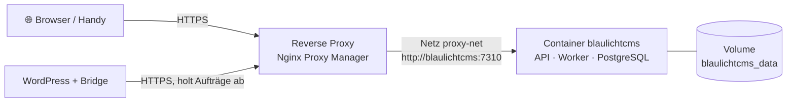

# Installation und Betrieb

Installation auf einem eigenen Linux-Server, Updates, Sicherung und Wiederherstellung, erste Schritte in der App und
das Verbinden einer WordPress-Website. Den technischen Aufbau beschreibt [technik.md](technik.md).

## Installation

BlaulichtCMS läuft auf einem Linux-Server mit Docker: ein Ordner unter `/opt/apps`, ein gemeinsames Docker-Netz
`proxy-net` und davor ein HTTPS-Reverse-Proxy (z. B. Nginx Proxy Manager).



### Voraussetzungen

| | |
|---|---|
| Server | Linux (z. B. Ubuntu 22.04/24.04 oder Debian 12/13), 2 CPU-Kerne und 4 GB RAM oder mehr |
| Software | Docker mit Compose-Plugin (`docker compose`), `git`, `curl` – fehlt etwas, bietet `install.sh` die Installation an |
| Speicher | mindestens 200 GB für `/var/lib/docker` (Fotos und Videos), Sicherungsziel möglichst auf einem anderen Datenträger |
| Netz | Reverse Proxy mit HTTPS-Zertifikat und einem DNS-Namen für BlaulichtCMS, z. B. `blaulichtcms.example.org` |

### Schritt 1: Installationsskript auf den Server holen

```bash
curl -fsSL https://raw.githubusercontent.com/thisislennard/BlaulichtCMS/main/install.sh -o install.sh
less install.sh   # vor dem Ausführen ansehen
```

Für einen privaten Fork: `BLAULICHTCMS_REPO=https://github.com/<konto>/<fork>.git` setzen; das Skript fragt dann nach
einem GitHub-Token mit Leserecht (*Contents: Read-only*) und speichert es nirgends.

### Schritt 2: Installieren

```bash
sudo bash install.sh
```

Das Skript führt durch alles Weitere und fragt nur zwei Dinge:

1. die **öffentliche Adresse**, z. B. `https://blaulichtcms.example.org`
2. **wo der Reverse Proxy läuft**: als Docker-Container auf diesem Server (z. B. Nginx Proxy Manager), direkt auf
   diesem Server (nginx, Caddy, Apache) oder auf einem anderen Server (z. B. IIS)

| Schritt | Was passiert |
|---|---|
| Voraussetzungen | bietet an, fehlendes Docker, git und curl zu installieren |
| Code | holt den neuesten freigegebenen Stand nach `/opt/apps/blaulichtcms` |
| Konfiguration | legt `.env` an; Port-Bindung und vertrauenswürdige Proxy-Adressen (`TRUSTED_PROXIES`) ergeben sich aus der Art des Proxys; ist Port 7310 belegt, schlägt es einen anderen vor |
| Netz | legt `proxy-net` an, erkennt einen Proxy-Container und verbindet ihn auf Wunsch |
| Image | baut `blaulichtcms:<version>-<commit>` (beim ersten Mal einige Minuten) |
| Start | startet den Container `blaulichtcms` und wartet, bis er gesund meldet |
| Sicherung | richtet auf Wunsch die tägliche, verschlüsselte Sicherung ein |
| Reverse Proxy | zeigt die passenden Werte zum Abtippen, wartet und **prüft die öffentliche Adresse** – bei einem Fehler mit Ursache (DNS, Zertifikat, Ziel nicht erreichbar …) |
| Sicherungsschlüssel | zeigt ihn an und lässt bestätigen, dass er getrennt abgelegt ist |
| Abschluss | zeigt Adresse und **Einrichtungsschlüssel** für die Ersteinrichtung im Browser |

Das Skript lässt sich jederzeit erneut starten – bei einer bestehenden Installation ist das ein Update.

### Schritt 3: Ersteinrichtung im Browser

Die angezeigte Adresse `…/einrichtung` öffnen, Einrichtungsschlüssel, Organisation und Zeitzone eingeben und das erste
Konto mit Zwei-Faktor-Anmeldung anlegen. Danach unter *Einstellungen → Datenschutz* Verantwortlichen und
Datenschutzerklärung eintragen und unter *Verwaltung → Benutzer und Rollen* die Redaktion einladen.

Werte für den Reverse Proxy zum Nachschlagen (Nginx Proxy Manager: Ziel `http` / `blaulichtcms` / `7310`, Advanced-Block)
und Beispiele für nginx, Caddy, Traefik, HAProxy und IIS: [docs/reverse-proxy.md](reverse-proxy.md).

### Optionen des Installationsskripts

| Variable / Schalter | Bedeutung | Standard |
|---|---|---|
| `--yes` | ohne Rückfragen (dann `BLAULICHTCMS_PUBLIC_URL` vorgeben) | – |
| `--rebuild` | Image ohne Codeänderung mit aktuellen Basis-Images neu bauen | – |
| `--no-cron` | keine tägliche Sicherung einrichten | – |
| `BLAULICHTCMS_DIR` | Installationsordner | `/opt/apps/blaulichtcms` |
| `BLAULICHTCMS_BACKUP_DIR` | Ziel der täglichen Sicherung (z. B. eingebundenes NAS) | `/opt/apps/blaulichtcms-sicherungen` |
| `BLAULICHTCMS_PUBLIC_URL` | öffentliche Adresse | Rückfrage |
| `BLAULICHTCMS_PROXY_MODE` | Art des Reverse Proxys: `1` Container auf diesem Server, `2` direkt auf diesem Server, `3` anderer Server | Rückfrage (`1`) |
| `BLAULICHTCMS_PROXY_IP` | IP des Reverse Proxys bei Art `3` | Rückfrage |
| `BLAULICHTCMS_BIND` / `BLAULICHTCMS_PORT` | Schnittstelle und Port am Host | `127.0.0.1` / `7310` |
| `BLAULICHTCMS_PROXY_NETWORK` | Docker-Netz des Reverse Proxys | `proxy-net` |
| `BLAULICHTCMS_REPO` | Quelle des Codes (eigener Fork) | dieses Repository |
| `BLAULICHTCMS_UPDATE_CHANNEL` | `release` (neuester Tag `v*`) oder `main` | `release`, solange es Tags gibt |
| `GITHUB_TOKEN` | nur für private Forks: Leserecht auf das Repository | Rückfrage bei Bedarf |
| `HTTPS_PROXY`, `NO_PROXY` | ausgehender Proxy für den Image-Build | – |
| `BLAULICHTCMS_BUILD_CA` | PEM-Datei einer Proxy-CA, falls der Proxy TLS aufbricht | – |

Beispiel ohne Rückfragen:
`sudo BLAULICHTCMS_PUBLIC_URL=https://blaulichtcms.example.org bash install.sh --yes`

### Was wo liegt

| | |
|---|---|
| Programm und `.env` | `/opt/apps/blaulichtcms` |
| Container | `blaulichtcms` (in `docker compose`-Befehlen heißt der Dienst `blaulichtcms`) |
| Daten (Datenbank, Medien, Hauptschlüssel) | Volume `blaulichtcms_data` |
| Sicherungen | `/opt/apps/blaulichtcms-sicherungen` (`taeglich/`, `woechentlich/`, `vor-update/`) |
| Protokolle | `docker compose logs -f blaulichtcms`, Sicherung: `/var/log/blaulichtcms-backup.log` |

> [!IMPORTANT]
> Die Sicherungen sind mit einem eigenen Sicherungsschlüssel verschlüsselt (`/etc/blaulichtcms/backup.key`, legt
> `install.sh` an). **Eine Kopie dieses Schlüssels getrennt verwahren** (Passwortmanager/Tresor) – ohne ihn ist keine
> Wiederherstellung möglich. Mindestens einmal im Monat eine Kopie der Sicherungen außer Haus bringen. `docker compose down -v` löscht das Volume
> und damit **alle Daten**. Für Neustarts und Updates nie `-v` verwenden.

---

## Update, Sicherung, Wiederherstellung

| Aufgabe | Befehl | Hinweis |
|---|---|---|
| **Update in der Oberfläche** | *Einstellungen → Updates* | normale Releases aus GitHub (Standard: dieses Repository, öffentlich – ohne Anmeldung, Token nur für private Repositories). Nur mit gültiger Signatur, mit Wartungsmodus, Datenbanksicherung und automatischem Rückweg; siehe [docs/betrieb.md](betrieb.md#in-app-update-einstellungen--updates) |
| **Update am Host** | `sudo bash /opt/apps/blaulichtcms/install.sh` | holt den neuen Stand, baut das Image, sichert, wechselt, prüft. Bei einem Fehler wird automatisch der vorherige Stand mit den vorherigen Daten wiederhergestellt. Nötig, wenn ein Release ein neues Image braucht – *Einstellungen → Updates* zeigt dann „Neues Docker-Image nötig“ (siehe [docs/betrieb.md](betrieb.md#neues-image-für-eine-bestehende-installation)) |
| **Image-Update aus der App** | *Einstellungen → Updates* → „Image-Update anstoßen“ | mit dem **Update-Helfer** (systemd-Dienst, richtet `install.sh` auf Rückfrage ein): Die App legt nur eine Anfrage-Datei ab, der Helfer prüft das signierte Release und führt den Ablauf von `install.sh` nicht-interaktiv aus – der Container erhält keinen Zugriff auf Docker. Abschalten: `sudo bash /opt/apps/blaulichtcms/install.sh --remove-helper`; siehe [docs/betrieb.md](betrieb.md#image-updates-aus-der-app-update-helfer) |
| Freigabe | Release-Tag `v<version>` (signiert) | Updates folgen dem neuesten Tag; Signaturprüfung mit `/etc/blaulichtcms/allowed_signers`, siehe [docs/betrieb.md](betrieb.md#freigabe-von-updates-release-tags-und-signatur) |
| Basis-Images erneuern | `sudo bash /opt/apps/blaulichtcms/install.sh --rebuild` | monatlich: baut das Image ohne Codeänderung mit aktuellen Basis-Images (Sicherheitsupdates von Debian, Node.js, PostgreSQL) neu und wechselt mit Sicherung und Rückweg |
| Sicherung jetzt | `cd /opt/apps/blaulichtcms && scripts/backup-volume.sh /pfad/zum/ziel` | vollständig (Datenbank, Medien, Schlüssel), verschlüsselt, mit Prüfsumme; der Container hält dafür wenige Sekunden an |
| Tägliche Sicherung | `/etc/cron.d/blaulichtcms` → `scripts/backup-cron.sh` | richtet `install.sh` ein; Aufbewahrung über `BLAULICHTCMS_KEEP_DAILY` und `BLAULICHTCMS_KEEP_WEEKLY`; Sicherungen vor Updates: letzte 3, höchstens 90 Tage (`BLAULICHTCMS_KEEP_PRE_UPDATE`, `BLAULICHTCMS_PRE_UPDATE_MAX_DAYS`) |
| Sicherung prüfen | `scripts/verify-backup.sh <archiv> [--voll]` | läuft nach jeder täglichen Sicherung automatisch; `--voll` (sonntags automatisch) stellt in eine Wegwerf-Instanz ohne Netzwerk wieder her |
| Wiederherstellung | `scripts/restore-volume.sh <archiv>` | in ein leeres Volume, siehe [docs/betrieb.md](betrieb.md#wiederherstellung) |
| Status | `docker compose ps` und `curl -s http://127.0.0.1:7310/healthz` | in BlaulichtCMS unter *Verwaltung → Systemstatus* |
| Notfall | `docker compose exec blaulichtcms node server/dist/cli.js password-link <email>` | weitere Befehle in [docs/betrieb.md](betrieb.md#notfall-befehle) |

Für die Betriebswerte (Speicher, Aufbewahrung, Wiederanlaufzeit) gibt es einen Vorschlag in
[docs/betrieb.md](betrieb.md#betriebsfestlegungen-vorschlag-bitte-bestätigen).

---

## Erste Schritte

Ein Durchlauf in etwa zehn Minuten:

1. **Einladen:** *Benutzer und Rollen → Benutzer einladen*, Rollen z. B. „Redaktion“ und „Medienverwaltung“. Den Link aufs Handy schicken, dort das Passwort setzen.
2. **Beitrag:** *Beiträge → Neuer Beitrag*.
3. **Sammeln:** Im Beitrag *Fotos und Videos sammeln*, QR-Code anzeigen, mit einem zweiten Handy scannen und ein Foto hochladen.
4. **Sichten:** *Medien → Sammlung → sichten*, dann **Auswählen**.
5. **Schreiben:** Text eingeben, *Medien übernehmen*, **Neue Fassung speichern**, **Zur Freigabe einreichen**.
6. **Freigeben:** Eine berechtigte Person gibt frei. Ohne Zielkanal ist der Beitrag jetzt *intern freigegeben*.
7. **Veröffentlichen:** Website koppeln (siehe unten), Zielkanal wählen, erneut freigeben, **Veröffentlichen**. Nach dem nächsten Abruf der Bridge steht die URL im Beitrag und im Dashboard.

Ausführlich im Hilfe-Center der App (`/hilfe`). Derselbe Ablauf läuft automatisiert als Abnahmetest:
[`test/e2e/m1-flow.mjs`](../test/e2e/m1-flow.mjs).

---

## WordPress verbinden

1. In BlaulichtCMS *Kanäle → Websites → Bridge herunterladen* (ZIP, aktuell Version 0.9.0).
2. In WordPress *Plugins → Installieren → Plugin hochladen*, dann aktivieren.
3. In BlaulichtCMS *Website koppeln*, den einmaligen **Kopplungscode** notieren (30 Minuten gültig).
4. In WordPress *Einstellungen → BlaulichtCMS Bridge* die BlaulichtCMS-Adresse (`https://…`) und den Code eintragen, dann **Koppeln**.

Die Bridge holt jede Minute über WP-Cron ab; ist WP-Cron abgeschaltet (`DISABLE_WP_CRON`), stößt sie den Abruf bei
Seitenaufrufen selbst an. Ein Host-Cron ist nicht nötig, hilft aber bei sehr wenig Besuchern oder einem Seitencache, der
PHP umgeht:

```cron
* * * * * wp --path=/var/www/html blaulichtcms-bridge poll
```

In *Einstellungen → BlaulichtCMS Bridge* lassen sich Autor (eigener Autor der Bridge, Person aus BlaulichtCMS oder
vorhandener Benutzer), Standardkategorie sowie Farbe und Darstellung der Hinweise je Schweregrad (Banner, Popup oder
beides) festlegen. Automatische Updates der Bridge schaltet man in der Plugin-Liste von WordPress ein.

Banner erscheinen automatisch am Seitenanfang (abschaltbar), alternativ per Block „BlaulichtCMS: Hinweise“ oder
`[blaulichtcms_banner]`. Die Einsatzübersicht kommt per `[blaulichtcms_einsaetze]`. Abgelaufene Banner verschwinden auch aus
zwischengespeicherten Seiten. Getestet ist die Bridge mit WordPress 7.1 und PHP 8.5, HTTPS mit Zertifikatsprüfung,
WP-Cron, Host-Cron und WP Super Cache ([Ergebnis](integrationen.md)). Schnittstelle: [docs/bridge-api.md](bridge-api.md).
